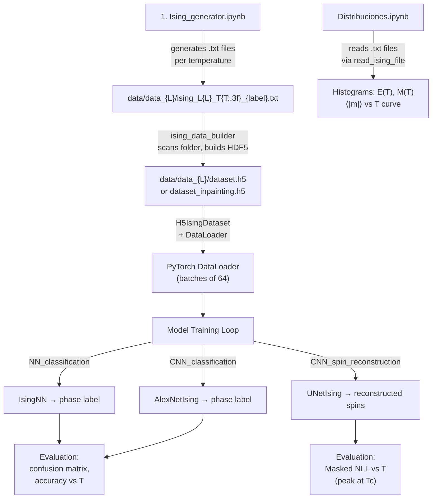

# Master Technical Context: Machine Learning for the 2D Ising Model

> **Repository**: `JD314/Ising-ML`
> **Generated**: 2026-09-30 — file-by-file inspection of all source code, notebooks, model checkpoints, and documentation.

---

## 1. Physical Foundations and Theoretical Framework

### 1.1 Hamiltonian

The project simulates the **classical 2D Ising model** on a square lattice. The Hamiltonian implemented in both the Monte Carlo generator (`Ising_generator.ipynb`, class `Ising_2D`) and the observable calculator (`utils.py`, methods `energy` / `calculate_energy`) is:

$$
\mathcal{H} = -J \sum_{\langle i,j \rangle} S_i S_j \;-\; H \sum_i S_i
$$

| Symbol | Meaning | Default value used |
|--------|---------|--------------------|
| $S_i \in \{-1, +1\}$ | Ising spin variable at site $i$ | — |
| $J$ | Exchange coupling constant (ferromagnetic when $J > 0$) | $J = 1$ |
| $H$ | External magnetic field | $H = 0$ |
| $\langle i,j \rangle$ | Sum over nearest-neighbour pairs | 4 neighbours on a 2D square lattice |

### 1.2 Boundary Conditions — Periodic (Toroidal)

The lattice is a 2D torus. In the code (`Ising_2D.pbc` and the vectorised energy calculations in `utils.py`), this is enforced as:

- **Horizontal**: `spin[:, -1]` interacts with `spin[:, 0]`
- **Vertical**: `spin[-1, :]` interacts with `spin[0, :]`

This eliminates edge effects and preserves translational invariance.

### 1.3 Lattice Sizes

| Lattice $L \times L$ | Used in |
|-----------------------|---------|
| $10 \times 10$ | `NN_classification.ipynb`, `CNN_classification.ipynb`, `Distribuciones.ipynb` |
| $20 \times 20$ | `Distribuciones.ipynb` (magnetisation vs temperature curve) |
| $30 \times 30$ | `CNN_spin_reconstruction.ipynb` (U-Net inpainting) |

### 1.4 Critical Temperature

The **Onsager exact critical temperature** for the 2D square-lattice Ising model with $J = 1, H = 0$ is computed in the codebase as:

$$
T_c = \frac{2J}{k_B \ln(1 + \sqrt{2})} \approx 2.269\,185\;J/k_B
$$

In natural units ($J = k_B = 1$) this reduces to $T_c \approx 2.269$. The code stores it as:

```python
self.T_c = 2 / np.log(1 + np.sqrt(2))   # ≈ 2.26918...
```

### 1.5 Temperature Regimes and Phase Classification Labels

| Phase | Temperature regime | Label (`class`) |
|-------|--------------------|-----------------|
| **Ordered (ferromagnetic)** | $T < T_c$ | `0` |
| **Disordered (paramagnetic)** | $T \ge T_c$ | `1` |

The label assignment is `int(T >= self.T_c)` — the boundary $T = T_c$ is classified as disordered (label `1`).

### 1.6 Thermodynamic Observables

The following observables are computed in `Distribuciones.ipynb` and `utils.py`:

#### 1.6.1 Total Energy

Vectorised implementation in `read_ising_file.calculate_energy` and `Ising_2D.total_energy`:

$$
E = -J \left[\sum_{i,j} S_{i,j}\,S_{i,j+1} + \sum_{i,j} S_{i,j}\,S_{i+1,j}\right] - H \sum_{i,j} S_{i,j}
$$

where the sums include periodic wrap-around terms. Code equivalent:

```python
E  = -J * np.sum(spin[:, :-1] * spin[:, 1:])     # horizontal bulk
E -= J * np.sum(spin[:, -1]  * spin[:, 0])        # horizontal PBC
E -= J * np.sum(spin[:-1, :] * spin[1:, :])       # vertical bulk
E -= J * np.sum(spin[-1, :]  * spin[0, :])        # vertical PBC
E -= H * np.sum(spin)                             # external field
```

#### 1.6.2 Magnetisation

**Total magnetisation** (unnormalised):

$$
M = \sum_{i,j} S_{i,j}
$$

```python
M = np.sum(spin)
```

**Absolute mean magnetisation per spin** (used in the $\langle |m| \rangle$ vs $T$ plot):

$$
\langle |m| \rangle = \frac{1}{N_{\text{samples}}} \sum_{k=1}^{N_{\text{samples}}} \frac{|M_k|}{L^2}
$$

```python
mean_m_per_spin = np.mean(np.abs(magnetization)) / (n * n)
```

#### 1.6.3 Energy and Magnetisation Distributions

`Distribuciones.ipynb` plots histograms (kernel density via `seaborn.histplot(..., stat="density")`) of $E$ and $M$ at eight selected temperatures: $T \in \{0.700, 1.000, 1.700, 2.000, 2.300, 3.000, 3.500, 4.000\}$.

> **Note**: Specific heat $C_v$ and magnetic susceptibility $\chi$ are **not** explicitly computed in the current codebase, although the raw data to derive them (per-sample $E$ and $M$ at fixed $T$) is generated. Their standard statistical-mechanics formulations are:
>
> $$C_v = \frac{\langle E^2 \rangle - \langle E \rangle^2}{k_B T^2}, \qquad \chi = \frac{\langle M^2 \rangle - \langle M \rangle^2}{k_B T}$$

---

## 2. Numerical Simulation & Monte Carlo Engine

### 2.1 Algorithm: Metropolis-Hastings (Single-Spin Flip)

The core sampler is a standard **Metropolis-Hastings** single-spin-flip algorithm implemented in `Ising_2D.metropolis_hasting()` inside `Ising_generator.ipynb`.

**Per step**:

1. Select a random site $(i, j)$ uniformly.
2. Compute the **local energy change** if the spin were flipped:

$$
\Delta E = -2\,S_{i,j}\left(-J\sum_{\text{nn}} S_{\text{nn}} + H\right) \cdot (-2) = -2 \times \text{energy}(S, i, j)
$$

In the code the local energy function returns $e_{ij} = -J\,S_{i,j}\sum_{\text{nn}} S_{\text{nn}} + H\,S_{i,j}$, and the flip change is computed as `Delta_E = -2.0 * self.energy(self.spin, i, j)`.

3. **Accept or reject**:
   - If $\Delta E \le 0$: accept (flip the spin).
   - If $\Delta E > 0$: accept with probability $P = e^{-\Delta E / T}$; draw $r \sim \text{Uniform}(0,1)$ and flip if $e^{-\Delta E/T} > r$.

> **No other algorithms** (Wolff cluster, Swendsen-Wang, Glauber) are implemented.

### 2.2 Sampling Pipeline — `generate_samples()`

The method `Ising_2D.generate_samples(L, T, samples, burn_in, interval, seed, H, J, folder)` executes the full data-generation pipeline:

| Stage | Implementation | Purpose |
|-------|---------------|---------|
| **1. Initialisation** | `build_system()` → all-ones lattice $S_{ij} = +1\;\forall\,i,j$ | Deterministic cold start |
| **2. Simulated annealing** | Loop $T_{\text{ann}} \in [5.0, T]$ in steps of $0.05$ (descending), 100 MC steps each | Cool from high $T$ to target to avoid trapping in metastable states |
| **3. Burn-in (thermalisation)** | `metropolis_hasting(burn_in)` at the target $T$ | Equilibrate the system |
| **4. Production sampling** | For each of `samples` samples, run `metropolis_hasting(interval)` then write the spin config to disk | Decorrelated samples from the canonical ensemble |

### 2.3 Simulation Hyperparameters (as used in the executed cells)

| Parameter | Value (classification, $L=10$) | Value (inpainting, $L=30$) |
|-----------|-------------------------------|---------------------------|
| Lattice size $L$ | 10 | 30 |
| Number of samples per $T$ | 2 000 | 2 000 |
| Burn-in sweeps | 5 000 single-spin steps | 5 000 single-spin steps |
| Sampling interval | 500 single-spin steps | 500 single-spin steps |
| Random seed | 73 | 73 |
| $H$ | 0 | 0 |
| $J$ | 1 | 1 |
| Temperature grid | `np.arange(0.1, 4.1, 0.1)` → 40 temperatures | `np.arange(0.1, 4.1, 0.1)` → 40 temperatures |
| Annealing range | $[T, 5.0]$ in steps of $0.05$, 100 MC steps each | Same |

### 2.4 Spin Configuration Encoding and Storage

#### Encoding

Spins are encoded as **$\{-1, +1\}$ integer values**. No $\{0, 1\}$ encoding is used at the simulation level. The $\{0, 1\}$ mapping appears **only** for the U-Net inpainting target:

$$
p = \frac{S + 1}{2} \quad \Longrightarrow \quad S = +1 \mapsto p = 1, \quad S = -1 \mapsto p = 0
$$

#### Raw File Format (`.txt`)

Each call to `generate_samples` creates one text file:

```
ising_L{L}_T{T:.3f}_{label}.txt
```

- **Line 1 (header)**: JSON metadata string, e.g.:
  ```json
  {"L": 10, "T": 2.3, "N": 5000, "class": 1, "burn_in": 2000, "interval": 100, "seed": 42, "H": 0, "J": 1}
  ```
- **Lines 2–(N+1)**: Flattened spin vectors, comma-separated `float` values (`1.0` or `-1.0`), one configuration per line.

Shape per configuration: flattened $L^2$ vector → reshaped to $(L, L)$ by `read_ising_file.reshape_spin`.

#### HDF5 Dataset Format (`.h5`)

Built by `ising_data_builder`. Two modes:

| Mode | HDF5 datasets | Shapes | Semantics |
|------|--------------|--------|-----------|
| `classification` | `X` : spins, `y` : labels | `X`: $(N_{\text{total}}, L, L)$ int, `y`: $(N_{\text{total}},)$ float | $X \in \{-1,+1\}$, $y \in \{0, 1\}$ (phase label) |
| `inpainting` | `X` : spins, `y` : probabilities | `X`: $(N_{\text{total}}, L, L)$ int, `y`: $(N_{\text{total}}, L, L)$ float | $X \in \{-1,+1\}$, $y = (X+1)/2 \in \{0, 1\}$ |

The dataset includes **spin-inverted copies** by default (`invert=True` in `load_all_spins`): for every configuration $\mathbf{S}$, the negated $-\mathbf{S}$ is also added, effectively doubling the dataset and enforcing the $\mathbb{Z}_2$ symmetry of the Ising model at $H = 0$.

**Total dataset size** (with inversion): $40\;\text{temperatures} \times 2000\;\text{samples} \times 2\;\text{(inversion)} = 160\,000$ configurations.

---

## 3. Machine Learning Architecture & Models

### 3.1 Overview of ML Tasks

| Task | Notebook | Architecture | Input | Output |
|------|----------|-------------|-------|--------|
| Binary phase classification | `models/NN_classification.ipynb` | Fully-connected NN (`IsingNN`) | $(L \times L)$ spin config $\in \{-1,+1\}$ | Logit → $P(\text{disordered})$ |
| Binary phase classification | `models/CNN_classification.ipynb` | CNN à la AlexNet (`AlexNetIsing`) | $(1, L, L)$ spin config | Logit → $P(\text{disordered})$ |
| Spin inpainting / reconstruction | `models/CNN_spin_reconstruction.ipynb` | U-Net (`UNetIsing`) | $(2, L, L)$: masked state + mask | $(1, L, L)$: per-pixel logit → $P(S = +1)$ |

### 3.2 Model 1 — Fully-Connected Neural Network (`IsingNN`)

**File**: `models/NN_classification.ipynb`, Cell 7.

```
Input (L²) → Flatten → Linear(L², 100) → ReLU
           → Linear(100, 100) → ReLU
           → Linear(100, 200) → ReLU
           → Linear(200, 100) → ReLU
           → Linear(100, 50)  → ReLU
           → Linear(50, 1)
```

| Property | Value |
|----------|-------|
| Input dimension | $L^2 = 100$ (for $L = 10$) |
| Hidden layers | 5 (widths: 100, 100, 200, 100, 50) |
| Activation | ReLU (all hidden layers) |
| Output activation | None (raw logit; sigmoid applied externally) |
| Total parameters | ~42 651 (estimated) |
| Loss function | `nn.BCEWithLogitsLoss` |
| Optimiser | Adam, $\text{lr} = 10^{-3}$ |
| Batch size | 64 |
| Epochs trained | 5 |
| Train/test split | 80/20, stratified by label, `random_state=4` |
| Data source | `../data/` (10×10 lattice, classification mode) |
| Decision boundary | $\sigma(\text{logit}) \ge 0.5 \Rightarrow \text{class } 1$ |

### 3.3 Model 2 — AlexNet-style CNN (`AlexNetIsing`)

**File**: `models/CNN_classification.ipynb`, Cell 7.

**Feature extractor (convolutional)**:

| Layer | Type | In→Out channels | Kernel | Stride | Padding | Output spatial |
|-------|------|-----------------|--------|--------|---------|----------------|
| 1 | `Conv2d` | 1 → 32 | 3×3 | 1 | 1 | 10×10 |
| 2 | `ReLU` | — | — | — | — | 10×10 |
| 3 | `MaxPool2d` | — | 2×2 | 2 | — | 5×5 |
| 4 | `Conv2d` | 32 → 64 | 3×3 | 1 | 1 | 5×5 |
| 5 | `ReLU` | — | — | — | — | 5×5 |
| 6 | `MaxPool2d` | — | 2×2 | 2 | — | 2×2 |
| 7 | `Conv2d` | 64 → 128 | 3×3 | 1 | 1 | 2×2 |
| 8 | `ReLU` | — | — | — | — | 2×2 |

**Classifier (fully-connected)**:

```
Flatten(128 × 2 × 2 = 512) → Dropout(0.5) → Linear(512, 256) → ReLU
                            → Dropout(0.5) → Linear(256, 128) → ReLU
                            → Linear(128, 1)
```

| Property | Value |
|----------|-------|
| Input shape | $(B, 1, 10, 10)$ — auto-unsqueezed if $(B, 10, 10)$ |
| Output | 1 logit per sample |
| Loss function | `nn.BCEWithLogitsLoss` |
| Optimiser | Adam, $\text{lr} = 10^{-3}$ |
| Batch size | 64 |
| Epochs | 5 |
| Regularisation | Dropout $p = 0.5$ (two layers) |
| Data source | `../data/data_10/` (10×10 lattice, classification mode) |

### 3.4 Model 3 — U-Net for Spin Inpainting (`UNetIsing`)

**File**: `models/CNN_spin_reconstruction.ipynb`, Cell 6.

This is the most sophisticated model. It performs **inpainting**: given a spin configuration with 5% of sites randomly masked, it predicts the probability $P(S_{ij} = +1)$ for **all** sites. The loss is evaluated **only** on the masked pixels.

#### 3.4.1 Building Blocks

| Block | Definition |
|-------|-----------|
| `DoubleConv(in, out)` | `Conv2d(in, out, 3, pad=1)` → `BatchNorm2d(out)` → `ReLU` → `Conv2d(out, out, 3, pad=1)` → `BatchNorm2d(out)` → `ReLU` |
| `Down(in, out)` | `MaxPool2d(2)` → `DoubleConv(in, out)` |
| `Up(in, out)` | `ConvTranspose2d(in, out, k=2, s=2)` → pad-to-match → `cat(skip, upsampled)` → `DoubleConv(in, out)` |
| `OutConv(in, out)` | `Conv2d(in, out, 1)` — 1×1 projection, no activation |

#### 3.4.2 Full Architecture

```
Input (B, 2, L, L)         # Channel 0: masked state; Channel 1: binary mask
  │
  ├─ inc:   DoubleConv(2, 64)       →  x1  (B, 64, L, L)
  ├─ down1: Down(64, 128)           →  x2  (B, 128, L/2, L/2)
  ├─ down2: Down(128, 256)          →  x3  (B, 256, L/4, L/4)
  ├─ down3: Down(256, 512)          →  x4  (B, 512, L/8, L/8)    [bottleneck]
  │
  ├─ up1:   Up(512, 256) + skip x3  → (B, 256, L/4, L/4)
  ├─ up2:   Up(256, 128) + skip x2  → (B, 128, L/2, L/2)
  ├─ up3:   Up(128, 64)  + skip x1  → (B, 64, L, L)
  │
  └─ outc:  OutConv(64, 1)          → (B, 1, L, L)   [logits]
```

For $L = 30$: spatial dimensions are $30 \to 15 \to 7 \to 3$ (encoder) and $3 \to 7 \to 15 \to 30$ (decoder, with padding to handle odd dimensions).

| Property | Value |
|----------|-------|
| Input channels | 2 (masked spins + binary mask) |
| Output channels | 1 (logit for $P(S=+1)$) |
| Encoder channels | 64 → 128 → 256 → 512 |
| Decoder channels | 256 → 128 → 64 |
| Skip connections | 3 (from each encoder level to the corresponding decoder level) |
| Normalisation | `BatchNorm2d` after every `Conv2d` |
| Activation | `ReLU(inplace=True)` |
| Upsampling | `ConvTranspose2d` (learnt, stride 2) |
| Total parameters | ~23 million (checkpoint files are ~89 MB each) |

#### 3.4.3 Masking Protocol

At each training step, a **random binary mask** is generated on the fly:

```python
mask_obs = (torch.rand((B, 1, H, W), device=device) > pct_mask).float()
# mask_obs = 1 for observed pixels, 0 for hidden pixels
```

| Parameter | Value |
|-----------|-------|
| `pct_mask` | 0.05 (5% of spins hidden) |
| Mask type | i.i.d. Bernoulli per pixel per sample |

**Model input construction**:

```python
state_masked = X * mask_obs                         # hidden sites zeroed out
model_input  = torch.cat([state_masked, mask_obs], dim=1)  # (B, 2, H, W)
```

#### 3.4.4 Training Protocol

| Property | Value |
|----------|-------|
| Loss function | `nn.BCEWithLogitsLoss(reduction='none')` — element-wise |
| Effective loss | $\displaystyle\mathcal{L} = \frac{\sum_{(i,j)\in\text{masked}} \text{BCE}(\hat{y}_{ij}, y_{ij})}{\#\text{masked pixels}}$ |
| Optimiser | Adam, $\text{lr} = 10^{-3}$ |
| Batch size | 64 |
| Epochs | 9 |
| Train/test split | 80/20, `random_state=4` (not stratified by label) |
| Data source | `../data/data_30/` ($30\times30$ lattice, inpainting mode) |
| Accuracy metric | Masked accuracy = fraction of correctly predicted masked pixels ($\hat{p} \ge 0.5$ vs ground truth) |

#### 3.4.5 Evaluation: Masked NLL vs Temperature

The key physics result is produced in Cell 11–12 of `CNN_spin_reconstruction.ipynb`:

$$
\text{Masked NLL}(T) = \frac{1}{|\mathcal{M}|} \sum_{(i,j) \in \mathcal{M}} -\left[y_{ij}\log\hat{p}_{ij} + (1-y_{ij})\log(1-\hat{p}_{ij})\right]
$$

This quantity **peaks near $T_c$**, indicating that reconstruction difficulty is maximised at the critical point where correlation lengths diverge and the system is maximally complex.

### 3.5 Inventory of `models/` Directory

#### 3.5.1 Notebooks

| File | Purpose |
|------|---------|
| `models/NN_classification.ipynb` | Train & evaluate fully-connected NN for phase classification ($L=10$) |
| `models/CNN_classification.ipynb` | Train & evaluate AlexNet-style CNN for phase classification ($L=10$) |
| `models/CNN_spin_reconstruction.ipynb` | Train & evaluate U-Net for spin inpainting ($L=30$) |

#### 3.5.2 Saved Checkpoints

| File | Size | Architecture | Contents |
|------|------|-------------|----------|
| `models/experiments/unet_ising/model.pt` | 89 MB | `UNetIsing` | `model_state`, `optimizer_state`, `hyperparams` dict |
| `models/experiments/unet_ising/model_v1.pt` | 89 MB | `UNetIsing` | Same structure (earlier version) |
| `models/experiments/unet_ising/config.yaml` | 315 B | — | YAML metadata for the U-Net experiment |

**Checkpoint structure** (`torch.save` dict):

```python
{
    "model_state":     OrderedDict,  # state_dict of UNetIsing
    "optimizer_state":  dict,         # Adam optimizer state
    "hyperparams": {
        "n_channels":    2,
        "out_channels":  1,
        "lr":            1e-3,
        "loss_fn":       "BCEWithLogitsLoss",
        "architecture":  "UNetIsing",
    }
}
```

**`config.yaml`**:

```yaml
model:
  architecture: UNetIsing
  n_channels: 2
  out_channels: 1
  encoder_channels: [64, 128, 256, 512]
  decoder_channels: [256, 128, 64]
training:
  optimizer: Adam
  lr: 0.001
  loss: BCEWithLogitsLoss
experiment:
  name: unet_ising
  save_dir: ./experiments/unet_ising
```

> **Note**: The NN and CNN classification models are **not** saved as checkpoint files. Only the U-Net has persisted weights.

---

## 4. Codebase Architecture & Functional Catalog

### 4.1 Project Tree & Responsibility Map

```
Ising_ML/
├── .gitignore                          # Ignores data/, *.pt, *.h5, img_results/, experiments/
├── README.md                           # Project documentation (Spanish)
├── Ising -ML.pdf                       # Accompanying academic report/paper (PDF)
├── Ising_generator.ipynb               # Monte Carlo data generation engine
├── Distribuciones.ipynb                # Statistical analysis & observable distributions
├── utils.py                            # Shared utility module (I/O, datasets, physics)
└── models/
    ├── .gitkeep                        # Placeholder to track empty directory
    ├── NN_classification.ipynb         # Fully-connected NN classifier
    ├── CNN_classification.ipynb        # AlexNet CNN classifier
    ├── CNN_spin_reconstruction.ipynb   # U-Net inpainting model
    └── experiments/
        └── unet_ising/
            ├── config.yaml             # U-Net experiment configuration
            ├── model.pt                # Trained U-Net checkpoint (latest)
            └── model_v1.pt             # Trained U-Net checkpoint (v1)
```

**Data directories** (git-ignored, generated at runtime):

```
data/
├── data_10/                # L=10 configurations + dataset.h5
├── data_20/                # L=20 configurations
└── data_30/                # L=30 configurations + dataset_inpainting.h5
img_results/                # Saved plots (PNG)
```

### 4.2 Complete API / Functional Catalog of `utils.py`

#### 4.2.1 Class `read_ising_file`

Reads and processes raw `.txt` simulation output files.

| Method | Signature | Returns | Description |
|--------|-----------|---------|-------------|
| `__init__` | `(self, file: str)` | — | Opens file, parses JSON header into `self.metadata` dict |
| `reshape_spin` | `(self, index: int)` → `np.ndarray` | $(L, L)$ int array | Reads line `index` from file, parses CSV floats, casts to int, reshapes to $(L, L)$ |
| `plot_spin` | `(self, spin_index=1, spin_arrows=True, slice=None)` | — | Displays spin configuration as B/W image with optional ↑/↓ arrows. `slice = [r0, r1, c0, c1]` crops the view |
| `magnetization` | `(self, index: int)` → `int` | $M = \sum S_{ij}$ | Total magnetisation of configuration at line `index` |
| `load_all_spins` | `(self, invert=True)` → `list[np.ndarray]` | List of $(L, L)$ arrays | Bulk-loads all configurations. If `invert=True`, also appends $-\mathbf{S}$ for each $\mathbf{S}$ (doubles dataset). Skips malformed lines |
| `energy` | `(self, index: int)` → `float` | $E$ | Total energy of configuration at line `index` (with PBC and field) |
| `calculate_energy` | `@staticmethod (spin, metadata)` → `float` | $E$ | Same as `energy` but takes a pre-loaded array (no I/O) |
| `calculate_magnetization` | `@staticmethod (spin)` → `int` | $M$ | Same as `magnetization` but takes a pre-loaded array |
| `invert_spins` | `@staticmethod (spin)` → `np.ndarray` | $-\mathbf{S}$ | Returns negated spin configuration |

#### 4.2.2 Class `ising_data_builder` (inherits `read_ising_file`)

Scans a folder of `.txt` simulation files and builds an HDF5 dataset.

| Method | Signature | Returns | Description |
|--------|-----------|---------|-------------|
| `__init__` | `(self, folder, invert=True, kind='classification', alpha=0.05)` | — | Scans folder, builds dataset according to `kind` |
| `_scan_folder` | `(self)` | — | Regex-filters files matching `ising_*` pattern |
| `_load_file` | `(self, file)` | — | Delegates to `read_ising_file.__init__` to load a single file |
| `_build_dataset` | `(self, h5_filename='dataset.h5')` → `str` | Path to `.h5` file | Creates classification HDF5: `X` = spins $(N, L, L)$, `y` = phase labels $(N,)$ |
| `_build_inpainting_dataset` | `(self, mask_ratio=0.05, h5_filename='dataset_inpainting.h5')` → `str` | Path to `.h5` file | Creates inpainting HDF5: `X` = spins $\{-1,+1\}$, `y` = $(X+1)/2 \in \{0,1\}$ |

**Key attributes after construction**: `self.h5_path` (path to the created HDF5), `self.n_samples` (total sample count).

#### 4.2.3 Class `H5IsingDataset` (extends `torch.utils.data.Dataset`)

PyTorch-compatible dataset for lazy-loading from HDF5.

| Method | Signature | Returns | Description |
|--------|-----------|---------|-------------|
| `__init__` | `(self, h5_path: str)` | — | Opens HDF5, stores handles to `X` and `y` datasets |
| `__len__` | `(self)` → `int` | $N$ | Number of samples |
| `__getitem__` | `(self, idx)` → `(Tensor, Tensor)` | $(x, y)$ | Returns `x` as `float32`, `y` as `long` tensors. Reads single sample from HDF5 on demand |
| `close` | `(self)` | — | Explicitly closes the HDF5 file handle |
| `__del__` | `(self)` | — | Auto-closes on garbage collection |

### 4.3 End-to-End Execution Flow



**Step-by-step**:

1. **Generate data**: Run `Ising_generator.ipynb`. The `Ising_2D` class produces one `.txt` file per temperature in `data/data_{L}/`.
2. **Analyse distributions** (optional): Run `Distribuciones.ipynb` to visualise energy/magnetisation histograms and the $\langle|m|\rangle$ vs $T$ curve.
3. **Build HDF5 dataset**: Inside each model notebook, `ising_data_builder(folder, kind=...)` scans the data folder and produces an HDF5 file.
4. **Create DataLoaders**: `H5IsingDataset` wraps the HDF5 file; `torch.utils.data.DataLoader` handles batching and shuffling.
5. **Train**: Each notebook defines its own model class, loss, optimiser, and runs a training loop.
6. **Evaluate**: Confusion matrices, per-temperature accuracy curves, and (for U-Net) the Masked NLL vs $T$ curve.
7. **Save** (U-Net only): Checkpoints saved via `torch.save` to `models/experiments/unet_ising/`.

---

## 5. Environment, Dependencies & Reproducibility

### 5.1 Python Version

All notebooks record **Python 3.12.4** in their kernel metadata (`pygments_lexer: ipython3, version: 3.12.4`).

### 5.2 Required Libraries

| Library | Role | Version constraint |
|---------|------|--------------------|
| **PyTorch** (`torch`) | Neural network framework, tensor operations, GPU support | ≥ 2.0 recommended |
| **NumPy** (`numpy`) | Array operations, spin configurations | ≥ 1.24 |
| **Matplotlib** (`matplotlib`) | Plotting (spin grids, loss curves, distributions) | ≥ 3.7 |
| **Seaborn** (`seaborn`) | Statistical histograms (energy/magnetisation distributions) | ≥ 0.12 |
| **scikit-learn** (`sklearn`) | `train_test_split`, `confusion_matrix` | ≥ 1.3 |
| **h5py** | HDF5 dataset I/O | ≥ 3.9 |
| **tqdm** | Progress bars for training and generation loops | ≥ 4.65 |
| **Numba** (`numba`) | JIT compilation (imported in `Ising_generator.ipynb` but `@njit` not actively decorating methods) | ≥ 0.58 |
| **PyYAML** (`yaml`) | Config file serialisation for U-Net experiment metadata | ≥ 6.0 |
| **Jupyter** | Notebook execution environment | ≥ 7.0 |

### 5.3 Reproducibility: Clean Environment Setup

```bash
# 1. Clone the repository
git clone https://github.com/JD314/Ising-ML.git
cd Ising-ML

# 2. Create and activate a virtual environment (Python 3.12+)
python3.12 -m venv .venv
source .venv/bin/activate

# 3. Upgrade pip
pip install --upgrade pip

# 4. Install all dependencies
pip install torch torchvision numpy matplotlib seaborn scikit-learn h5py tqdm numba pyyaml jupyter ipykernel

# 5. Register the kernel for Jupyter
python -m ipykernel install --user --name=ising-ml --display-name "Ising-ML"

# 6. Create data directories
mkdir -p data/data_10 data/data_20 data/data_30 img_results

# ─────────────────────────────────────────────────
# PIPELINE EXECUTION
# ─────────────────────────────────────────────────

# 7. Generate Monte Carlo data (≈ hours for L=30)
jupyter nbconvert --to notebook --execute Ising_generator.ipynb --ExecutePreprocessor.timeout=-1

# 8. (Optional) Analyse distributions
jupyter nbconvert --to notebook --execute Distribuciones.ipynb --ExecutePreprocessor.timeout=-1

# 9. Train classification models (L=10)
cd models
jupyter nbconvert --to notebook --execute NN_classification.ipynb --ExecutePreprocessor.timeout=-1
jupyter nbconvert --to notebook --execute CNN_classification.ipynb --ExecutePreprocessor.timeout=-1

# 10. Train U-Net inpainting model (L=30, GPU recommended)
jupyter nbconvert --to notebook --execute CNN_spin_reconstruction.ipynb --ExecutePreprocessor.timeout=-1
cd ..
```

### 5.4 GPU Support

All model notebooks use:

```python
device = torch.device("cuda" if torch.cuda.is_available() else "cpu")
```

The U-Net with ~23M parameters benefits significantly from GPU acceleration; classification models are lightweight enough for CPU.

### 5.5 `.gitignore` Notes

The following are git-ignored and must be regenerated locally:

- `data/` — all simulation data
- `*.pt`, `*.pth`, `*.pkl` — model checkpoints
- `*.h5`, `*.hdf5` — HDF5 datasets
- `img_results/` — saved plots
- `experiments/` — experiment outputs

---

## Appendix A: Key Mathematical Formulae Quick Reference

| Quantity | Formula | Code location |
|----------|---------|---------------|
| Hamiltonian | $\mathcal{H} = -J\sum_{\langle i,j\rangle} S_i S_j - H\sum_i S_i$ | `Ising_2D.energy`, `read_ising_file.calculate_energy` |
| Critical temperature | $T_c = \frac{2}{\ln(1+\sqrt{2})} \approx 2.269$ | `Ising_2D.__init__` |
| Local energy change | $\Delta E = 2J\,S_{ij}\sum_{\text{nn}} S_{\text{nn}} - 2H\,S_{ij}$ | `Ising_2D.metropolis_hasting` |
| Acceptance probability | $P_{\text{accept}} = \min\!\left(1,\; e^{-\Delta E / T}\right)$ | `Ising_2D.metropolis_hasting` |
| Spin → probability map | $p = (S + 1)/2$ | `ising_data_builder._build_inpainting_dataset` |
| Masked NLL | $\frac{1}{|\mathcal{M}|}\sum_{(i,j)\in\mathcal{M}} \text{BCE}(\hat{y}_{ij}, y_{ij})$ | `CNN_spin_reconstruction.ipynb`, Cell 9/11 |

## Appendix B: Notebook Cell Maps

### B.1 `Ising_generator.ipynb` (6 cells)

| Cell | Type | Content |
|------|------|---------|
| 0 | Markdown | Metropolis-Hastings algorithm description with LaTeX equations |
| 1 | Markdown | PBC, simulated annealing, burn-in, and sampling strategy |
| 2 | Code | `Ising_2D` class definition (full MC engine) |
| 3 | Markdown | File system output specification table |
| 4 | Code | Batch generation loop: 40 temperatures, L=10, 2000 samples each |
| 5 | Code | Empty |

### B.2 `Distribuciones.ipynb` (11 cells)

| Cell | Type | Content |
|------|------|---------|
| 0 | Code | Imports (`numpy`, `matplotlib`, `seaborn`, `utils.read_ising_file`) |
| 1 | Markdown | Title: "Análisis de Distribuciones del Modelo Ising" |
| 2 | Code | File scanning: regex-filter temperatures, select 8 target files |
| 3 | Markdown | Section: "Red de espines" |
| 4 | Code | Spin grid visualisation call |
| 5 | Markdown | Section: "Distribución de Energía" |
| 6 | Code | 2×4 grid of energy histograms at 8 temperatures |
| 7 | Markdown | Section: "Distribución de Magnetización" |
| 8 | Code | 2×4 grid of magnetisation histograms at 8 temperatures |
| 9 | Markdown | Section: "Magnetización Promedio vs Temperatura" |
| 10 | Code | $\langle|m|\rangle / L^2$ vs $T$ plot (L=20) |

### B.3 `models/NN_classification.ipynb` (16 cells)

| Cell | Type | Content |
|------|------|---------|
| 0 | Code | Imports |
| 1 | Markdown | Title |
| 2 | Markdown | Section: dataset construction |
| 3 | Code | Build HDF5 dataset |
| 4 | Markdown | Section: train/test split |
| 5 | Code | Stratified split, DataLoaders |
| 6 | Markdown | Section: model definition |
| 7 | Code | `IsingNN` class + model/loss/optimiser instantiation |
| 8 | Markdown | Section: training functions |
| 9 | Code | `train_epoch`, `eval_epoch` functions |
| 10 | Markdown | (empty) |
| 11 | Code | Training loop (5 epochs) |
| 12 | Markdown | Section: confusion matrix |
| 13 | Code | Confusion matrix computation and heatmap |
| 14 | Markdown | Section: accuracy per temperature |
| 15 | Code | Per-temperature accuracy analysis and plot |

### B.4 `models/CNN_classification.ipynb` (17 cells)

| Cell | Type | Content |
|------|------|---------|
| 0 | Code | Imports |
| 1 | Markdown | Title |
| 2–3 | Markdown + Code | Dataset construction |
| 4–5 | Markdown + Code | Train/test split |
| 6–7 | Markdown + Code | `AlexNetIsing` class definition |
| 8–9 | Markdown + Code | Training/evaluation functions |
| 10 | Code | Training loop (5 epochs) + metric storage |
| 11 | Code | Loss/accuracy curve plots |
| 12–13 | Markdown + Code | Confusion matrix |
| 14–15 | Markdown + Code | Per-temperature accuracy |
| 16 | Code | `dataset.close()` |

### B.5 `models/CNN_spin_reconstruction.ipynb` (15 cells)

| Cell | Type | Content |
|------|------|---------|
| 0 | Code | Imports |
| 1 | Markdown | Inpainting task description |
| 2 | Markdown | Section: dataset + split |
| 3 | Code | Build inpainting dataset, split, DataLoaders |
| 4 | Code | (commented `dataset.close()`) |
| 5 | Markdown | Section: model |
| 6 | Code | `DoubleConv`, `Down`, `Up`, `OutConv`, `UNetIsing` classes + instantiation |
| 7 | Code | Load pre-trained checkpoint (optional) |
| 8 | Markdown | Section: training & evaluation |
| 9 | Code | `train_epoch`, `eval_epoch` with masked loss/accuracy |
| 10 | Code | Training loop (9 epochs) |
| 11 | Code | Masked NLL vs temperature evaluation |
| 12 | Code | Plot Masked NLL vs $T$ with $T_c$ vertical line |
| 13 | Markdown | Section: save model |
| 14 | Code | `torch.save` checkpoint + YAML config |
