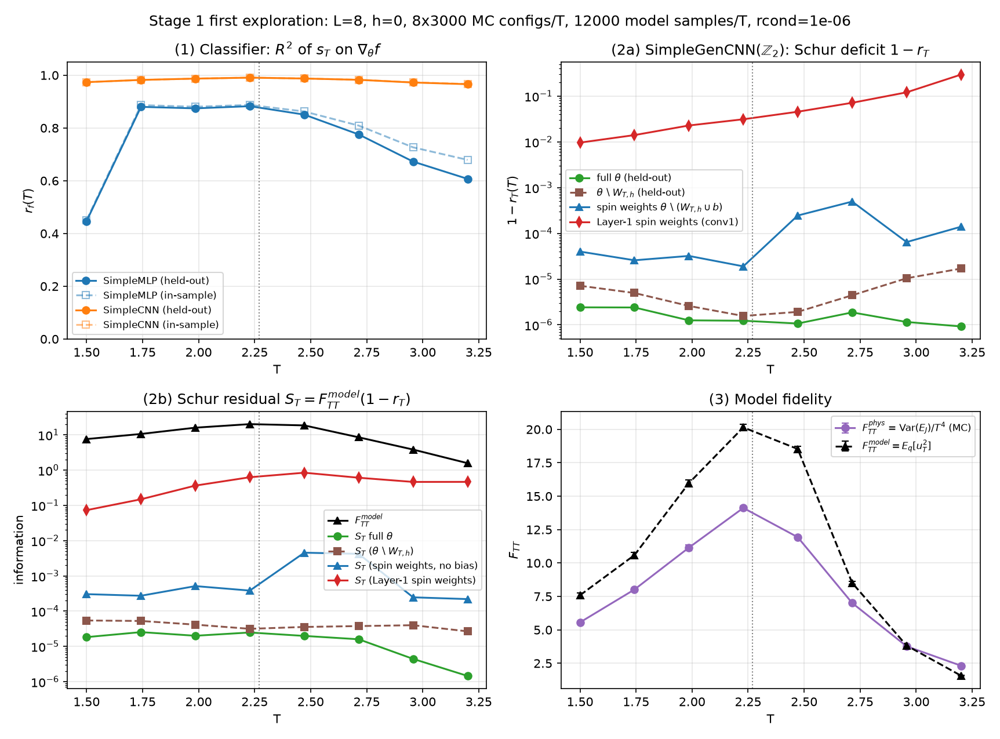

# Information Geometry & Fisher Schur Invariants in the 2D Ising Model

This repository investigates **parameter-space and physical Fisher information geometry** in neural networks (discriminative classifiers and autoregressive generative models) trained across the second-order phase transition of the classical 2D ferromagnetic Ising model ($T_c = \frac{2}{\ln(1+\sqrt{2})} \approx 2.269$).

---

## Repository Structure

    Ising_ML/
    ├── ising_fisher/                  # Stage 1 Fisher Schur Invariant package
    │   ├── mc.py                      # Numba-accelerated 2D Ising Metropolis sampler (in sweeps)
    │   ├── observables.py             # Exact L<=4 enumeration & physical Fisher F(T, h)
    │   ├── dataset.py                 # HDF5 dataset I/O with chain-grouped train/eval splits
    │   ├── fisher.py                  # Per-sample scores (vmap), Schur invariant r_c, S_c, and r_f
    │   ├── train.py                   # Classifier (BCE) and Generator (Forward KL) training loops
    │   └── models/
    │       ├── classifier.py          # Lightweight SimpleMLP & circular-padded SimpleCNN
    │       └── gen_cnn.py             # MaskedConv2d & Z2-equivariant autoregressive SimpleGenCNN
    ├── scripts/
    │   ├── generate_mc.py             # CLI generator for multi-chain MC HDF5 datasets
    │   └── run_first_exploration.py   # End-to-end Stage 1 pipeline & figure generator
    ├── tests/                         # 44 unit tests (MC, normalization, Z2, Identities a-d)
    ├── img_results/
    │   ├── first_exploration.png      # Stage 1 exploration summary plot (L=8)
    │   └── first_exploration.json     # Numerical results from Stage 1 exploration
    ├── CONTEXT_ISING_ML.md            # Technical specification and code audit documentation
    └── legacy_baseline/               # Original baseline notebooks (MLP, AlexNet CNN, U-Net)
        ├── Ising_generator.ipynb
        ├── Distribuciones.ipynb
        ├── utils.py
        ├── models/
        └── README_legacy.md

---

## Theoretical Framework (`ising_fisher/`)

### 1. Physical Fisher Information
For the 2D Ising Hamiltonian $\mathcal{H} = -J \sum_{\langle i,j \rangle} s_i s_j - h \sum_i s_i$ with interaction energy $E_J = -J \sum_{\langle i,j \rangle} s_i s_j$ and magnetization $M = \sum_i s_i$, the physical Fisher information matrix in control space $c \in \{T, h\}$ is:

$$F_{TT} = \frac{\operatorname{Var}(E_J - hM)}{T^4}, \qquad F_{hh} = \frac{\operatorname{Var}(M)}{T^2}, \qquad F_{Th} = \frac{\operatorname{Cov}(E_J - hM, M)}{T^3}$$

### 2. The Parameter–Physical Schur Invariant ($r_c, S_c$)
For a conditional generative model $q_\theta(x \mid c)$ with exact log-likelihood, we evaluate the parameter score $u_\theta(x) = \nabla_\theta \log q_\theta(x \mid c)$ and control score $u_c(x) = \partial_c \log q_\theta(x \mid c)$ on model samples $x \sim q_\theta(\cdot \mid c)$:

$$F_\theta = \mathbb{E}_q[u_\theta u_\theta^\top], \qquad G_c = \mathbb{E}_q[u_\theta u_c], \qquad F_{cc}^{\text{model}} = \mathbb{E}_q[u_c^2]$$

The **Schur invariant** $r_c \in [0, 1]$ and **Schur residual** $S_c$ are defined as:

$$r_c = \frac{G_c^\top F_\theta^+ G_c}{F_{cc}^{\text{model}}}, \qquad S_c = F_{cc}^{\text{model}}(1 - r_c)$$

* **Invariance:** $r_c$ is strictly invariant under invertible weight reparametrizations ($\theta \to \phi(\theta)$) and control-parameter chart transformations ($T \leftrightarrow \beta$).
* **Exact Structural Identities Verified in `tests/test_fisher.py`:**
  * **(a) Reparametrization Invariance:** $u_\theta \to A u_\theta$ leaves $r_c$ invariant to machine precision ($< 10^{-10}$).
  * **(b) Classifier Vanishing:** For discriminative classifiers $p_\theta(y \mid x)$ with model-sampled labels $y \sim p_\theta(y \mid x)$, $G_T \equiv 0$ and $r_T \equiv 0$.
  * **(c) $\mathbb{Z}_2$-Equivariant Vanishing:** For $q_\theta(-x \mid -h) = q_\theta(x \mid h)$ evaluated at $h = 0$, $r_h \equiv 0$ and $F_{Th}^{\text{model}} \equiv 0$.
  * **(d) Function-Space Classifier Invariant $r_f(T)$:** Held-out $R^2$ of regressing the physical thermal score $s_T = (E_J - \langle E_J \rangle)/T^2$ onto classifier logit gradients $\nabla_\theta f(x)$.

---

## Stage 1 Exploration Results ($L = 8, h = 0$)

* **Classifier $r_f(T)$:** `SimpleCNN` spans $>96.6\%$ of the physical thermal score variance across the entire temperature grid and peaks at $T \approx T_c$ with $r_f^{\text{heldout}} = 0.9908$ using an effective Fisher rank of only 18.
* **Generative Schur Deficit $1 - r_T(T)$ & Residual $S_T(T)$:** Restricting to spin-interaction weights removes trivial conditioning/bias redundancies and reveals a sharp critical maximum in the uncaptured Fisher information $S_T$ across $T_c$.

---

## Quickstart

    # 1. Activate virtual environment
    source .venv/bin/activate

    # 2. Run the full validation suite (44 unit tests)
    python -m pytest -v

    # 3. Run the Stage 1 exploration pipeline
    python scripts/run_first_exploration.py --L 8 --nT 8
