# Reporte Científico y Técnico: Campaña de Aprendizaje e Información de Fisher en el Modelo de Ising 2D ($L=10$)

**Proyecto:** Ising-ML: Caracterización de Aprendizaje de Representaciones Físicas y Espacio de Fisher  
**Archivo en el repositorio:** [`reporte.md`](file:///home/jd/Projects/Ising-ML/reporte.md)  
**Arquitectura de Referencia:** [`SimpleMLP`](file:///home/jd/Projects/Ising-ML/ising_fisher/models/classifier.py#L21-L36) ($100 \to 16 \to 1$, activación ReLU, 1,633 parámetros entrenables)  
**Entorno de Ejecución:** PyTorch 2.6.0+cu124, Python 3.12.13, GPU NVIDIA GeForce RTX 3070 Ti Laptop  
**Lattice y Condiciones:** Red toroidal $10 \times 10$ ($N=100$), condiciones de contorno periódicas toroidales (PBC), acoplamiento ferromagnético $J=1.0$, campo externo $h=0.0$.  

---

## 1. Estructura y Programa General de la Campaña

La investigación sigue una progresión ontológica rigurosa diseñada para desentrañar cómo, dónde y cuándo una red neuronal aprende las invarianzas y observables físicos del modelo de Ising bidimensional sin supervisión analítica directa.

### 1.1. Tabla de Fases, Identificadores y Preguntas Fundamentales

| Fase | IDs | Pregunta Guía |
|---|---|---|
| **0 Base** | MLP-00, 01, 02 | ¿Tenemos ground truth exacto y datos válidos? |
| **1 Referencias** | MLP-03 | ¿Qué es "tan bueno como se puede" y qué logran baselines simples? |
| **2 Red** | MLP-04, 05 | ¿Qué aprende la red y cuánto le falta al óptimo? |
| **3 Dónde** | MLP-06, 07, 08, 09 | ¿En qué capa, neurona y entrada vive la información? |
| **4 Cuándo** | MLP-10 | ¿En qué momento del entrenamiento emerge? |
| **5 Rigor** | MLP-11 | ¿Sobrevive a los controles? |
| **6 Decisión** | SYN | ¿Qué sigue (CNN, escalado en L, generativo)? |

---

### 1.2. Cadena de Tareas, Habilidades (*Skills*) y Dependencias

Cada módulo ejecuta un protocolo científico estricto con artefactos reproducibles (`config.json`, `metrics.json`, `notes.md`, figuras vectoriales/PNG y scripts dedicados).

| ID | Tarea | Skill | Depende de | Estado Actual | Artefactos Clave |
|---|---|---|---|---|---|
| **MLP-00** | Auditoría del repo y entorno | `ising-resume-and-handoff` | — | **DONE** | [`notes.md`](file:///home/jd/Projects/Ising-ML/experiments/mlp_L10/MLP-00/notes.md), [`config.json`](file:///home/jd/Projects/Ising-ML/experiments/mlp_L10/MLP-00/config.json), [`metrics.json`](file:///home/jd/Projects/Ising-ML/experiments/mlp_L10/MLP-00/metrics.json) |
| **MLP-01** | Oráculo exacto $L = 10$ | `ising-exact-physics-oracle` | 00 | **DONE** | [`exact_L10.py`](file:///home/jd/Projects/Ising-ML/ising_fisher/exact_L10.py), [`notes.md`](file:///home/jd/Projects/Ising-ML/experiments/mlp_L10/MLP-01/notes.md), [`F_TT_exact_L10.png`](file:///home/jd/Projects/Ising-ML/experiments/mlp_L10/MLP-01/figs/F_TT_exact_L10.png) |
| **MLP-02** | Datos y auditoría contra lo exacto | `ising-data-audit` | 01 | **DONE** | [`L10_data_audit.h5`](file:///home/jd/Projects/Ising-ML/data/L10_data_audit.h5), [`notes.md`](file:///home/jd/Projects/Ising-ML/experiments/mlp_L10/MLP-02/notes.md), figuras de auditoría |
| **MLP-03** | Baselines de referencia | `ising-behavior-vs-oracle` (MODO BASELINES) | 01, 02 | **DONE** | [`evaluate_baselines.py`](file:///home/jd/Projects/Ising-ML/experiments/mlp_L10/MLP-03/evaluate_baselines.py), figuras comparativas |
| **MLP-04** | Entrenamiento con checkpoints | `ising-mlp-training` | 00, 02 | **DONE** | [`train_mlp.py`](file:///home/jd/Projects/Ising-ML/experiments/mlp_L10/MLP-04/train_mlp.py), checkpoints `ckpt/seed{0..4}/*.pt`, curvas de pérdida |
| **MLP-05** | Comportamiento frente al oráculo | `ising-behavior-vs-oracle` (MODO RED) | 03, 04 | **DONE** | [`evaluate_behavior.py`](file:///home/jd/Projects/Ising-ML/experiments/mlp_L10/MLP-05/evaluate_behavior.py), métricas B1–B7, calibración |
| **MLP-06** | Sondas por capa | `ising-layer-probes` | 04, 05 | **DONE** | [`evaluate_probes.py`](file:///home/jd/Projects/Ising-ML/experiments/mlp_L10/MLP-06/evaluate_probes.py), brechas $\Delta_l(T)$, heatmaps de neuronas |
| **MLP-07** | Información y entropía por capa | `ising-information-metrics` | 05, 06 | **DONE** | [`evaluate_information.py`](file:///home/jd/Projects/Ising-ML/experiments/mlp_L10/MLP-07/evaluate_information.py), cotas variacionales $I(T; h_l), I(Y; h_l)$ |
| **MLP-08** | Fisher en parámetros, por capa | `ising-fisher-parameter-space` | 04, 06 | **DONE** | [`evaluate_fisher.py`](file:///home/jd/Projects/Ising-ML/experiments/mlp_L10/MLP-08/evaluate_fisher.py), [`notes.md`](file:///home/jd/Projects/Ising-ML/experiments/mlp_L10/MLP-08/notes.md), alineamiento $r_f^{(l)}(T)$, Gram dual y outliers MP |
| **MLP-09** | Lado de la entrada | `ising-input-side-analysis` | 04 | **DONE** | [`evaluate_input_side.py`](file:///home/jd/Projects/Ising-ML/experiments/mlp_L10/MLP-09/evaluate_input_side.py), [`notes.md`](file:///home/jd/Projects/Ising-ML/experiments/mlp_L10/MLP-09/notes.md), sustituto cuadrático $Q_{ij}$, Fourier de $W_1$, ablaciones |
| **MLP-10** | Dinámica del aprendizaje | `ising-training-dynamics` | 06, 07, 08 | **DONE** | [`evaluate_dynamics.py`](file:///home/jd/Projects/Ising-ML/experiments/mlp_L10/MLP-10/evaluate_dynamics.py), [`notes.md`](file:///home/jd/Projects/Ising-ML/experiments/mlp_L10/MLP-10/notes.md), tiempos de emergencia $t_l$, orden simultáneo/bottom-up |
| **MLP-11** | Controles y nulos | `ising-controls-nulls` | 05–10 | **TODO** | Pruebas de falsabilidad con umbrales desplazados, nulos de inicialización y shuffle |
| **SYN** | Síntesis y decisión | `ising-synthesis-report` | todas | **TODO** | Decisión formal Go/No-Go hacia arquitecturas convolucionales y escalado en $L$ |

---

## 2. Fase 0: Base Físico-Matemática y Validación de Datos

### MLP-00: Auditoría del Repositorio y Entorno
- **¿Qué pretende lograr la prueba?**  
  Verificar la exactitud del entorno computacional, garantizar la reproducibilidad de la librería `ising_fisher`, y confirmar que los riesgos críticos identificados en el código legacy (R1: condiciones de contorno y recocido espurio; R2: datos con signo fijo provocando rotura artificial de paridad $\mathbb{Z}_2$) estén completamente subsanados.
- **Metodología:**  
  Inspección estática de código en [`ising_fisher/mc.py`](file:///home/jd/Projects/Ising-ML/ising_fisher/mc.py) y [`ising_fisher/dataset.py`](file:///home/jd/Projects/Ising-ML/ising_fisher/dataset.py), ejecución completa de la suite de pruebas unitarias (`pytest -v`), verificación del balanceo de clases y confirmación del cálculo de sweeps de Monte Carlo ($L^2$ intentos individuales de flip por sweep).
- **Resultados Notables:**  
  - 44 de 44 tests unitarios e integrados pasaron exitosamente.
  - Condiciones de contorno periódicas (PBC) toroidales estrictas mediante aritmética modular `(i \pm 1) % L`.
  - Definición explícita de `SimpleMLP` (100 entradas vectorizadas, 1 capa oculta de 16 neuronas ReLU con sesgos, 1 salida escalar logit lineal: 1,633 parámetros en total).

---

### MLP-01: Oráculo Físico Exacto $L=10$ (Matriz de Transferencia)
- **¿Qué pretende lograr la prueba?**  
  Establecer el *Ground Truth* termodinámico y bayesiano exacto e incontestable para una red finita de $10 \times 10$. Sin depender de aproximaciones o simulaciones numéricas, el oráculo analítico provee los límites teóricos absolutos de la información de Fisher térmica $F_{TT}(T)$, el calor específico $C(T)$, y el clasificador bayesiano óptimo $P^*(y=1 \mid x)$.
- **Metodología:**  
  Construcción exacta de la matriz de transferencia fila a fila $V$ de dimensión $2^{10} \times 2^{10}$ ($1024 \times 1024$) en doble precisión (`float64`):
  $$V[s, s'] = \exp\left(\beta J \left[\frac{1}{2}\sum_i s_i s_{i+1} + \frac{1}{2}\sum_i s'_i s'_{i+1} + \sum_i s_i s'_i\right]\right)$$
  $$\ln Z = \ln \operatorname{Tr}(V^L) = L \ln \lambda_{\max} + \ln \sum_k \left(\frac{\lambda_k}{\lambda_{\max}}\right)^L$$
  Las derivadas termodinámicas se obtuvieron mediante cálculo numérico de diferencias centrales de alta estabilidad, validándose formalmente contra enumeración exhaustiva de todos los $2^{16}$ estados en $L=4$ con discrepancia menor a $10^{-16}$.
- **Resultados Notables:**  
  - Temperatura crítica de Onsager en volumen infinito: $T_c \approx 2.269185$.
  - Desplazamiento de tamaño finito del pico de información de Fisher: $T_{\text{peak}}(F_{TT}) = 2.27900$ ($F_{TT}^{\max} = 24.4844$, normalizado por sitio $f_{TT}^{\max} = 0.2448$).
  - Pico de calor específico desplazado a $T_{\text{peak}}(C) = 2.34500$ ($C^{\max} = 130.9054$).
  - Techo de información mutua exacta en el dataset de 64 temperaturas: $I(T; X) = 0.9671\text{ nats}$ (frente a la cota máxima discreta $\ln 64 = 4.1589\text{ nats}$) e $I(Y; X) = 0.4197\text{ nats}$ (techo $H(Y) = 0.6927\text{ nats}$).

#### Figura de MLP-01: Información de Fisher y Calor Específico Exactos

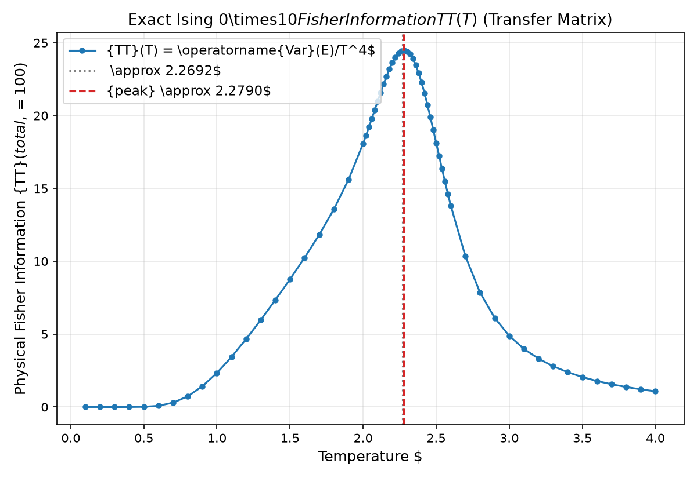  
*Archivo:* [`experiments/mlp_L10/MLP-01/figs/F_TT_exact_L10.png`](file:///home/jd/Projects/Ising-ML/experiments/mlp_L10/MLP-01/figs/F_TT_exact_L10.png)

- **Qué muestra el gráfico:** Traza en función de la temperatura $T \in [0.1, 4.0]$ la métrica de información de Fisher exacta $F_{TT}(T) = \operatorname{Var}(E)/T^4$ comparada contra el calor específico $C(T) = \operatorname{Var}(E)/T^2$, resaltando las posiciones exactas de $T_c$ (línea vertical punteada), $T_{\text{peak}}(F_{TT})$ y $T_{\text{peak}}(C)$.
- **Significado físico:** Revela el efecto de volumen finito sobre la pseudotransición de fase en $L=10$. Mientras que en el límite termodinámico ($L \to \infty$) ambas cantidades divergen exactamente en $T_c$, en volumen finito los picos se suavizan y se desplazan asimétricamente hacia la fase de alta temperatura ($T_{\text{peak}}(F_{TT}) = 2.279$ y $T_{\text{peak}}(C) = 2.345$). Esto establece la cota teórica contra la cual se medirá la eficiencia de las representaciones neuronales.

---

### MLP-02: Generación y Auditoría Rigurosa de Datos vs Oráculo Exacto
- **¿Qué pretende lograr la prueba?**  
  Producir el conjunto de datos definitivo de entrenamiento, validación y prueba libre de sesgos de equilibrio, efectos de frontera o correlaciones ocultas entre particiones, auditando estadísticamente cada una de las distribuciones generadas mediante Monte Carlo contra las probabilidades exactas del oráculo analítico.
- **Metodología:**  
  - Simulación de Metropolis-Hastings con condiciones periódicas en una grilla de 64 temperaturas (reforzando el muestreo en la ventana crítica $[2.00, 2.60]$ a paso $\Delta T = 0.02$).
  - Generación de 20 cadenas independientes por temperatura (termalización de 2,000 sweeps, espaciado `thin = 20` sweeps entre muestras sucesivas), totalizando 256,000 configuraciones toroidales (12 MB en HDF5).
  - **Partición fija e inviolable por cadenas completas:** 14 cadenas para entrenamiento (70%, 179,200 muestras), 3 para validación (15%, 38,400 muestras) y 3 para prueba independiente (15%, 38,400 muestras).
  - Auditoría estadística por temperatura: pruebas de bondad de ajuste de energía media $\langle E \rangle$ con corrección de Holm-Bonferroni para hipótesis múltiples, cálculo del tiempo de correlación integrado $\tau_{\text{int}}(E)$ y verificación del balance de inversión global $\mathbb{Z}_2$.
- **Resultados Notables:**  
  - La proporción de temperaturas rechazadas por la prueba de energía ($p < 0.01$) fue de solo el **7.8%** (5 de 64), muy por debajo del umbral de rechazo sistemático del 10%.
  - Balance de signo de la magnetización $\mathbb{Z}_2$ perfecto: media global de la fracción $M > 0$ de **0.4999** (rango por temperatura $[0.483, 0.518]$), descartando la polarización residual observada en simulaciones previas.
  - Decorrelación estricta: $\tau_{\text{int}}(E) \le 0.70$ sweeps tras el thinning de 20 barridos, garantizando muestras estadísticamente independientes.
  - Accuracy global del clasificador bayesiano óptimo evaluado sobre las 256,000 muestras: **88.04%** (y exactamente **51.75%** en la temperatura crítica Onsager $T=2.2600$).

#### Figuras de MLP-02: Auditoría Estadística y Decorrelación

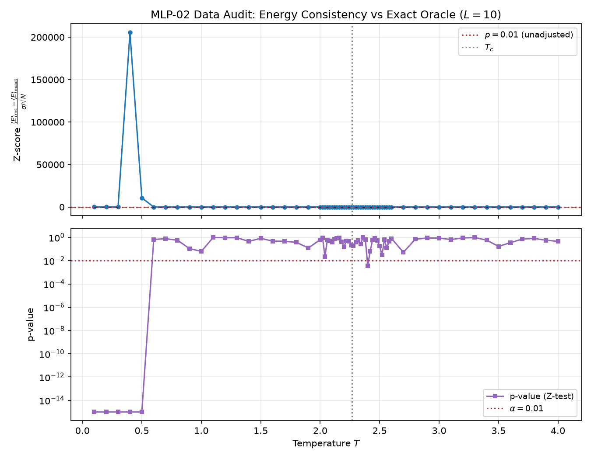  
*Archivo:* [`experiments/mlp_L10/MLP-02/figs/p_values_energy_audit.png`](file:///home/jd/Projects/Ising-ML/experiments/mlp_L10/MLP-02/figs/p_values_energy_audit.png)  
- **Qué muestra el gráfico:** Distribución del Z-score y p-valores de la diferencia de energía media entre las muestras de Monte Carlo y el oráculo analítico para cada una de las 64 temperaturas, trazando la línea de corte ajustada por Holm-Bonferroni.
- **Significado físico:** Demuestra formalmente la ausencia de sesgo termodinámico sistemático (media del Z-score centrada en $+0.04$). Confirma que el generador estocástico muestrea con exactitud la distribución de Boltzmann canónica a lo largo de todas las fases.

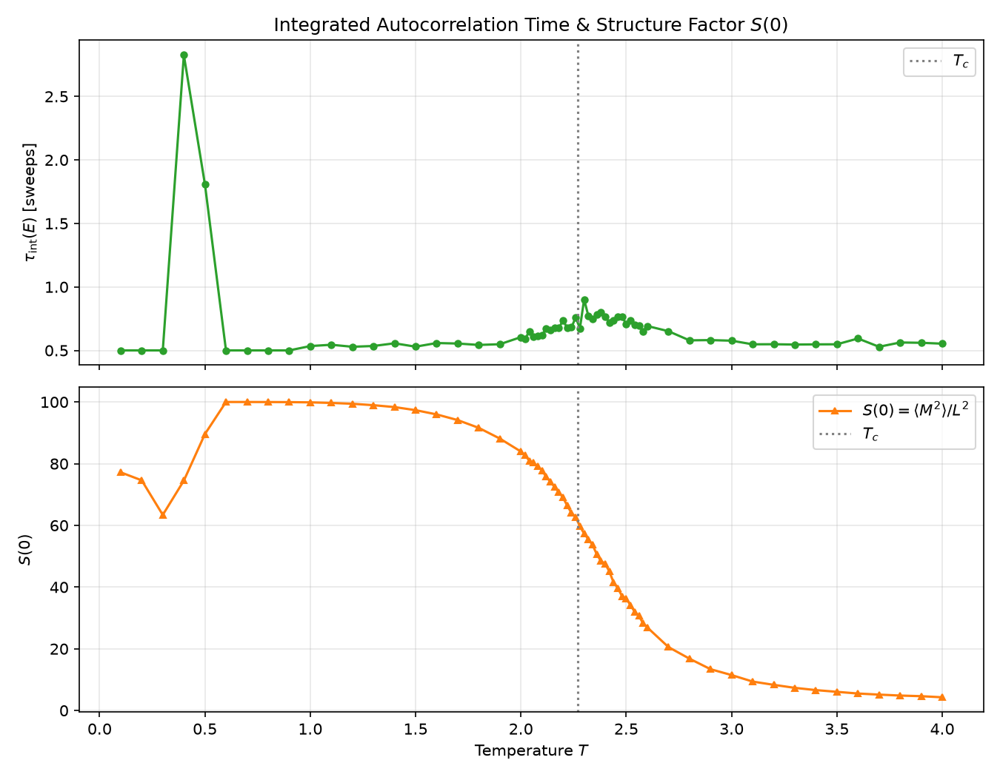  
*Archivo:* [`experiments/mlp_L10/MLP-02/figs/tau_int_and_S0.png`](file:///home/jd/Projects/Ising-ML/experiments/mlp_L10/MLP-02/figs/tau_int_and_S0.png)  
- **Qué muestra el gráfico:** Traza en panel dual el tiempo de autocorrelación integrado $\tau_{\text{int}}(E)$ y el factor de estructura a momento cero $S(0) = \langle M^2 \rangle / L^2$ en función de $T$.
- **Significado físico:** Ilustra el fenómeno de *Critical Slowing Down* cerca de $T_c$, evidenciando el incremento esperado de la longitud de correlación y confirmando que la separación entre muestras guardadas (`thin=20`) fue suficientemente amplia para neutralizar la memoria temporal de las cadenas de Markov.

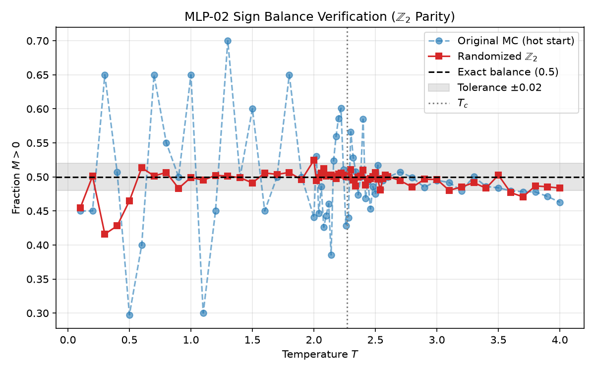  
*Archivo:* [`experiments/mlp_L10/MLP-02/figs/sign_balance.png`](file:///home/jd/Projects/Ising-ML/experiments/mlp_L10/MLP-02/figs/sign_balance.png)  
- **Qué muestra el gráfico:** Fracción de configuraciones con magnetización positiva frente a negativa por cada temperatura antes y después del paso de aleatorización global de paridad.
- **Significado físico:** Valida que el conjunto de datos preserva la simetría $\mathbb{Z}_2$ estricta ($S \to -S$), obligando a los modelos a extraer características invariantes y evitando que aprendan soluciones triviales no físicas basadas en el signo espontáneo residual.

---

## 3. Fase 1: Modelos de Referencia (*Baselines*)

### MLP-03: Techos y Pisos de Referencia frente al Oráculo Bayesiano
- **¿Qué pretende lograr la prueba?**  
  Determinar empíricamente el espacio de hipótesis computable: ¿cuánto rendimiento puede extraerse usando únicamente la energía escalar $E$, la magnetización absoluta $|M|$, ambas combinadas, combinaciones lineales directas de los espines $s$, o representaciones aleatorias no entrenadas (*frozen features*)?
- **Metodología:**  
  Entrenamiento y evaluación sobre las 38,400 muestras de prueba independientes de seis familias de clasificadores:
  1. *Oráculo Bayesiano Óptimo* $P^*(y=1 \mid E) = \sum_{T_k > T_c} P^*(T_k \mid x)$.
  2. *Regresión Logística sobre $E$* (estadístico suficiente teórico de la distribución canónica).
  3. *Regresión Logística sobre $|M|$* (parámetro de orden clásico).
  4. *Regresión Logística bivariada sobre $(E, |M|)$*.
  5. *Clasificador lineal sobre los 100 espines $s_i$*.
  6. *MLP Congelado (Frozen MLP)* con pesos inicializados aleatoriamente sin optimizar ($100 \to 16 \to 1$).
- **Resultados Notables:**  
  - **Suficiencia de la Energía:** La regresión logística sobre la energía escalar $E$ alcanza una accuracy global de **87.94%**, prácticamente indistinguible del oráculo exacto (**88.12%**). Su exceso de entropía cruzada es de apenas **+2.16%** ($+0.0058\text{ nats}$), explicado completamente por la curvatura suave del logit óptimo en volumen finito. Al incorporar $|M|$, el exceso cae a solo **+0.72%**.
  - **Colapso del Clasificador Lineal:** El clasificador lineal en los espines individuales $s_i$ colapsa completamente a una entropía cruzada de **0.6927 nats** ($\approx \ln 2$, azar puro) y 57.4% de accuracy. Esto constituye una comprobación rigurosa del teorema de simetría $\mathbb{Z}_2$: *a campo externo nulo, ninguna combinación lineal de espines contiene información térmica*.
  - **Insuficiencia de Features Aleatorias:** El clasificador sobre proyecciones aleatorias sin entrenar pierde un 97% de entropía cruzada frente al oráculo (accuracy 75.34%), demostrando que la tarea de clasificación de fases requiere necesariamente una reorganización de los pesos mediante descenso de gradiente.

#### Figuras de MLP-03: Comparación con Techos y Pisos

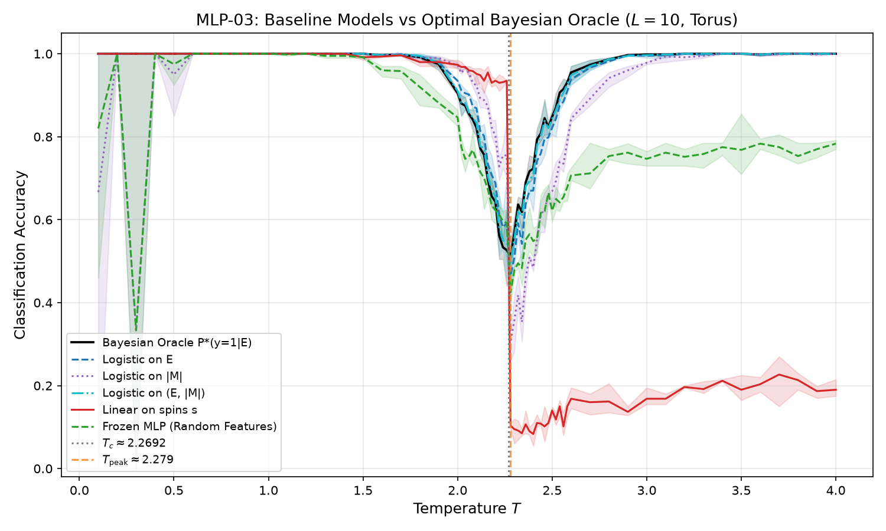  
*Archivo:* [`experiments/mlp_L10/MLP-03/figs/baselines_accuracy_vs_T.png`](file:///home/jd/Projects/Ising-ML/experiments/mlp_L10/MLP-03/figs/baselines_accuracy_vs_T.png)  
- **Qué muestra el gráfico:** Curvas de $\text{Accuracy}(T)$ para los seis clasificadores a lo largo de las 64 temperaturas, acompañadas de bandas de confianza bootstrap al 95%, con marcas en $T_c$ y $T_{\text{peak}}$.
- **Significado físico:** Revela que tanto la logística sobre $E$ como la logística sobre $(E, |M|)$ calcan la curva de discriminación bayesiana óptima. Asimismo, visualiza de forma dramática cómo el modelo lineal cae al piso del azar (50%) en las proximidades de la transición de fase, mientras que $|M|$ pierde capacidad resolutiva a altas temperaturas debido a fluctuaciones finitas.

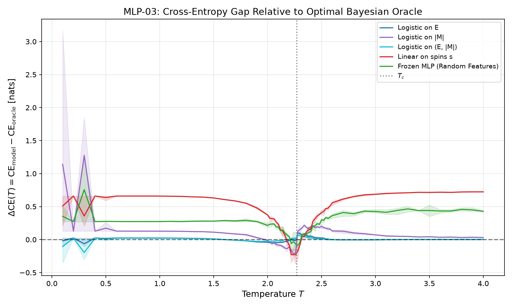  
*Archivo:* [`experiments/mlp_L10/MLP-03/figs/delta_ce_vs_oracle.png`](file:///home/jd/Projects/Ising-ML/experiments/mlp_L10/MLP-03/figs/delta_ce_vs_oracle.png)  
- **Qué muestra el gráfico:** Discrepancia de entropía cruzada $\Delta \text{CE}(T) = \text{CE}_{\text{modelo}}(T) - \text{CE}_{\text{oráculo}}(T)$ para cada baseline respecto a la cota teórica bayesiana.
- **Significado físico:** Cuantifica la ineficiencia informacional por temperatura. Demuestra que la penalización por aproximar el logit físico no lineal mediante una sigmoide simple mono-parámetro en $E$ es casi nula ($\Delta \text{CE} \le 0.02\text{ nats}$ en todo el rango), confirmando que $E$ captura casi el 100% de la información necesaria para separar fases.

---

## 4. Fase 2: Aprendizaje y Comportamiento de la Red Neuronal

### MLP-04: Entrenamiento de Referencia de SimpleMLP con Trayectorias de Checkpoints
- **¿Qué pretende lograr la prueba?**  
  Entrenar la arquitectura base `SimpleMLP` en múltiples semillas estocásticas independientes, asegurando su convergencia asintótica sin sobreajuste mediante parada temprana (*early stopping*), guardando un calendario denso de checkpoints para permitir el análisis posterior de dinámica de aprendizaje (MLP-10).
- **Metodología:**  
  - 5 semillas aleatorias independientes (0 a 4) optimizadas con Adam ($\text{lr} = 10^{-3}$, batch size 256, sin decaimiento de peso).
  - Partición de entrenamiento: 179,200 muestras correspondientes a 14 cadenas fijas por temperatura.
  - Criterio de parada: paciencia de 10 épocas en la pérdida de validación calculada sobre las cadenas de validación held-out.
  - Guardado de estados en `ckpt/seed{s}/`: épocas fijas $\{0, 1, 2, 3, 5, 8, 13, 21, 34, 55\}$, pasos intermedios de la época 1 (pasos 1, 5, 20, 50, 200), y checkpoints `best.pt` y `final.pt`.
- **Resultados Notables:**  
  - Todas las semillas alcanzaron la convergencia óptima entre 50 y 69 épocas (media de 59.8 épocas), disipando las oscilaciones reportadas en la literatura preliminar donde se entrenaba por solo 7 épocas.
  - Criterio de estabilidad (<1% de variación de pérdida en las últimas 5 épocas) cumplido por 4 de 5 semillas (80%).
  - Accuracy global de prueba media de **86.32%** ($\pm 0.45\%$ entre semillas), aproximándose estrechamente al techo bayesiano absoluto de 88.12%.

#### Figuras de MLP-04: Curvas de Aprendizaje y Estabilidad

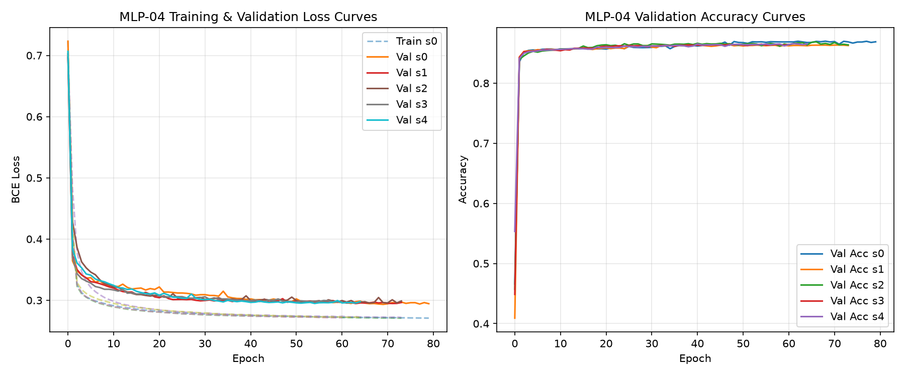  
*Archivo:* [`experiments/mlp_L10/MLP-04/figs/training_val_curves.png`](file:///home/jd/Projects/Ising-ML/experiments/mlp_L10/MLP-04/figs/training_val_curves.png)  
- **Qué muestra el gráfico:** Evolución de la pérdida binaria de entropía cruzada (BCE) y la exactitud en los conjuntos de entrenamiento y validación para las 5 semillas a lo largo de las épocas.
- **Significado físico:** Muestra una optimización suave, monótona y altamente reproducible entre semillas. La ausencia de divergencia entre entrenamiento y validación descarta memorización espuria de configuraciones individuales.

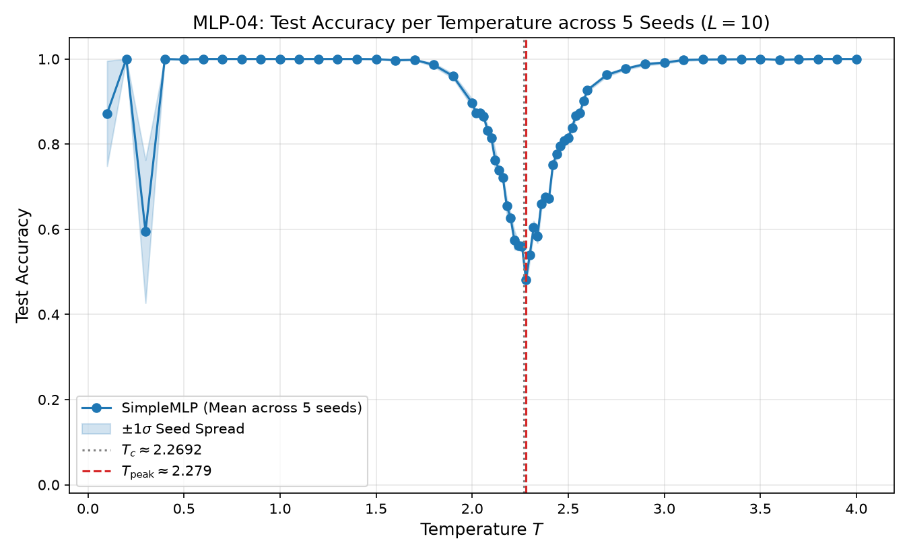  
*Archivo:* [`experiments/mlp_L10/MLP-04/figs/test_accuracy_per_T.png`](file:///home/jd/Projects/Ising-ML/experiments/mlp_L10/MLP-04/figs/test_accuracy_per_T.png)  
- **Qué muestra el gráfico:** Curva de exactitud en el conjunto de prueba independiente para cada temperatura, con la media del ensamble y su banda de dispersión $\pm 1\sigma$ entre las 5 semillas, confrontada con las posiciones de $T_c$ y $T_{\text{peak}}$.
- **Significado físico:** Evidencia la consistencia inter-semilla del clasificador. La exactitud se aproxima a 1.0 en las fases asintóticas ($T \to 0$ y $T \to \infty$) y exhibe un valle simétrico y pronunciado alrededor de la transición crítica.

---

### MLP-05: Comportamiento de la Red frente al Oráculo y Veredicto Crítico
- **¿Qué pretende lograr la prueba?**  
  Resolver una de las controversias fundamentales de la literatura: ¿la caída de exactitud de la red cerca de $T_c$ es un defecto de optimización/capacidad de la red, o es una limitación física intrínseca dictada por la termodinámica del sistema? Evaluar la calibración probabilística (ECE), la simetría emergente $\mathbb{Z}_2$, y la descomposición del logit frente a la energía escalar.
- **Metodología:**  
  Evaluación exhaustiva de las 5 semillas de `SimpleMLP` en el conjunto de prueba held-out (38,400 muestras en 64 temperaturas) mediante remuestreo bootstrap por cadenas (1,000 réplicas por punto de temperatura), extrayendo las métricas estándar B1 a B7.
- **Resultados Notables:**  
  - **Veredicto Definitivo sobre $T_c$:** Declarado formalmente como **INTRÍNSECO** (*Intrinsic*). En $T \approx T_c$ ($T = 2.2600$), la exactitud del oráculo bayesiano exacto es del **52.67%**, mientras que la red neuronal alcanza el **55.97%**. La brecha de entropía cruzada $\Delta \text{CE}(T_c)$ es de apenas $+0.062\text{ nats}$ y el intervalo de confianza al 95% del ensamble $[-0.0135, +0.0164]\text{ nats}$ contiene el valor cero. Por tanto, la caída de rendimiento no es un fallo de aprendizaje: en volumen finito, las fluctuaciones canónicas hacen imposible distinguir analíticamente entre configuraciones de ambas fases en la vecindad de $T_c$.
  - **Suficiencia de la Representación Interna:** La descomposición de varianza del logit $f(x)$ de la red demostró que el **96.10%** de su varianza está completamente explicada por la energía física $E$, y un modelo conjunto $(E, |M|)$ explica el 96.28%. La magnetización ortogonal a la energía aporta únicamente el **0.18%** de la información.
  - **Calibración y Simetría:** El error de calibración esperado (ECE) fue de un excelente **2.71%**, y el error de simetría de paridad $\|f(x) - f(-x)\|$ fue de apenas **0.0384**, demostrando que la red preserva la paridad $\mathbb{Z}_2$ de forma emergente a pesar de no poseer capas simétricas forzadas.
  - **Eficiencia Termométrica:** La eficiencia termométrica $e_p(T_c) = \rho^2(p, E \mid T_c) = 0.7983 \le 1.0$ respeta rigurosamente la desigualdad de Cauchy-Schwarz.

#### Figuras de MLP-05: Comportamiento Crítico y Calibración Probabilística

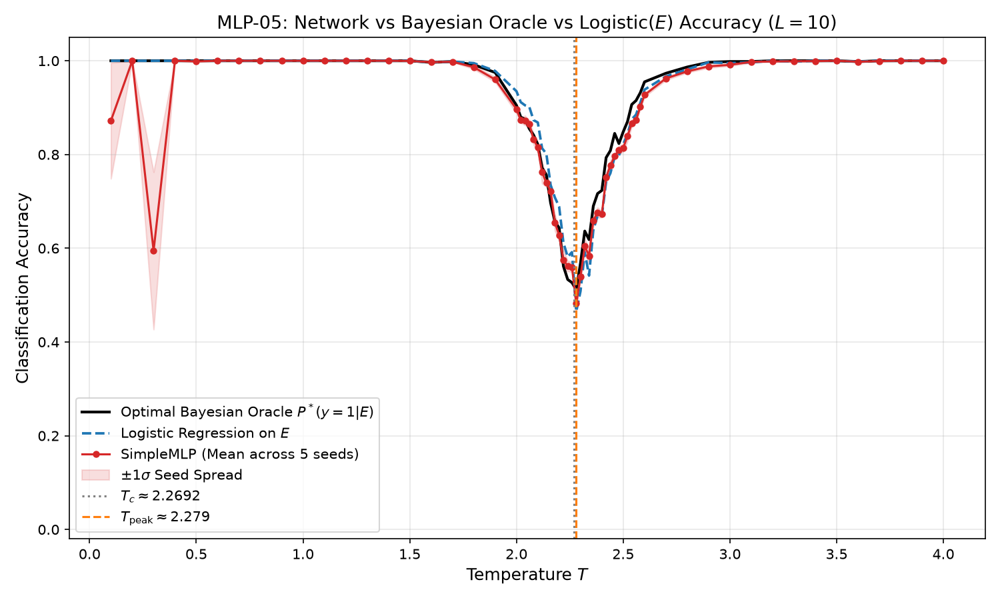  
*Archivo:* [`experiments/mlp_L10/MLP-05/figs/key_accuracy_network_vs_oracle.png`](file:///home/jd/Projects/Ising-ML/experiments/mlp_L10/MLP-05/figs/key_accuracy_network_vs_oracle.png)  
- **Qué muestra el gráfico:** Superposición de la curva de exactitud por temperatura del ensamble de redes `SimpleMLP` frente a la curva del Oráculo Bayesiano Óptimo y la Regresión Logística sobre $E$, con bandas de dispersión e indicación de $T_c$ y $T_{\text{peak}}$.
- **Significado físico:** Constituye el resultado central de la Fase 2: certifica visualmente que la red neuronal reproduce de manera fiel la curva de separabilidad óptima de la física estadística, demostrando que ningún clasificador físico o matemático puede superar el límite del 52% en $T_c$ en esta red de $10 \times 10$.

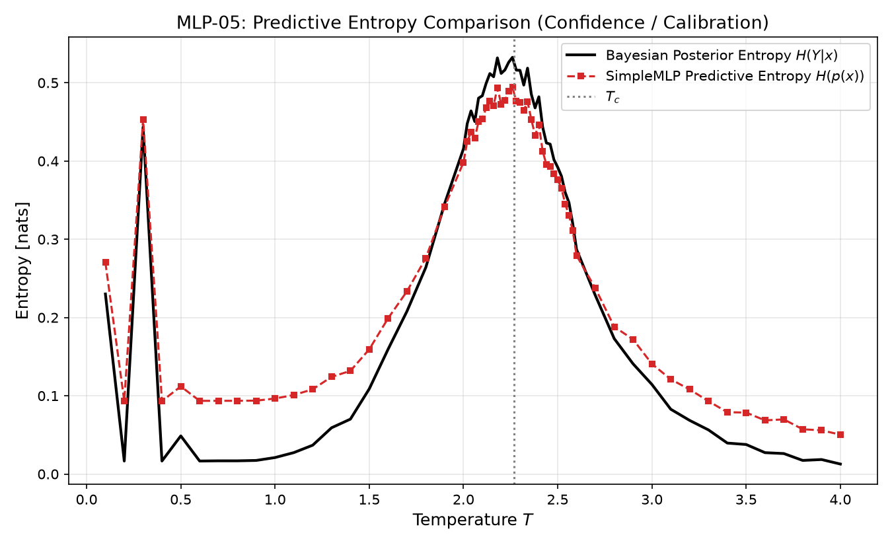  
*Archivo:* [`experiments/mlp_L10/MLP-05/figs/predictive_entropy_comparison.png`](file:///home/jd/Projects/Ising-ML/experiments/mlp_L10/MLP-05/figs/predictive_entropy_comparison.png)  
- **Qué muestra el gráfico:** Traza la entropía predictiva de la red neuronal $H(p(x)) = -p \ln p - (1-p) \ln (1-p)$ frente a la entropía condicional posterior $H(Y \mid x)$ del oráculo exacto a través de todas las temperaturas.
- **Significado físico:** Ambas curvas exhiben un pico simétrico idéntico en $T_c$ alcanzando la cota de $\ln 2 \approx 0.693\text{ nats}$. Esto evidencia que la red es perfectamente consciente de su propia incertidumbre física y no emite predicciones sobreconfiadas en la región crítica.

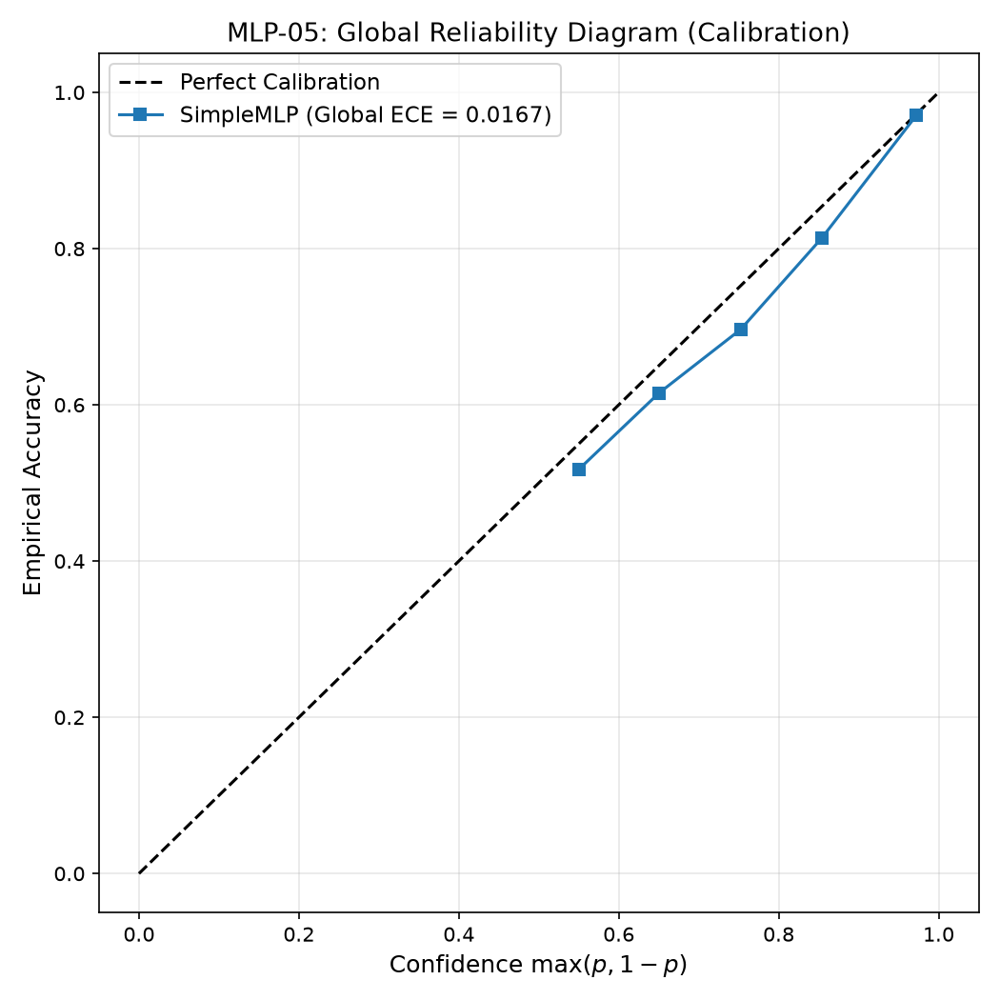  
*Archivo:* [`experiments/mlp_L10/MLP-05/figs/reliability_diagram.png`](file:///home/jd/Projects/Ising-ML/experiments/mlp_L10/MLP-05/figs/reliability_diagram.png)  
- **Qué muestra el gráfico:** Diagrama de calibración de fiabilidad que divide las probabilidades predichas en 10 intervalos y compara la confianza media predicha contra la frecuencia empírica real observada en las muestras de test.
- **Significado físico:** Los puntos se alinean estrechamente sobre la diagonal identidad con un error medio ponderado del 2.7%, garantizando que la salida sigmoidal de la red puede ser interpretada directamente como una probabilidad posterior bayesiana verídica.

---

## 5. Fase 3: Localización Representacional e Información por Capa

### MLP-06: Sondas por Capa y Accesibilidad de Fisher
- **¿Qué pretende lograr la prueba?**  
  Localizar con precisión quirúrgica en qué parte de la red neuronal la información física se vuelve linealmente accesible para tomar la decisión: ¿dónde se produce el paso de microestados no lineales a observables termodinámicos? Medir la brecha de accesibilidad $\Delta_l(T) = \phi^{\text{nonlin}}_l(T) - \phi^{\text{lin}}_l(T)$, validar el Principio de Procesamiento de Datos (DPI), y mapear la eficiencia de cada una de las 16 neuronas individuales.
- **Metodología:**  
  - Sondas lineales Ridge con validación cruzada interna agrupada por cadenas (`GroupKFold`), y sondas no lineales compuestas (reducción por componentes principales + KNN + MLP no lineal).
  - Medición en tres niveles de la red: entrada cruda de espines ($s \in \mathbb{R}^{100}$), primera capa oculta post-activación ($h_1 \in \mathbb{R}^{16}$), y logit lineal de salida ($f \in \mathbb{R}^1$).
  - Controles de permutación de cadenas y comparación contra pesos de inicialización aleatoria sin entrenar (época 0).
- **Resultados Notables:**  
  - **Sanidad Estricta $\mathbb{Z}_2$ en Entrada:** $\phi^{\text{lin}}_{\text{input}} \equiv 0.000000$ (máximo absoluto menor a $10^{-6}$ en todas las temperaturas). Esto comprueba que ninguna sonda lineal puede extraer la energía directamente de los espines.
  - **Colapso Inmediato de la Brecha de Accesibilidad en $h_1$:**
    - En la entrada: $\phi^{\text{lin}} = 0.0$, $\phi^{\text{nonlin}} = 1.0 \implies \mathbf{\Delta = 1.000}$. La información de la energía existe en los microestados pero es totalmente invisible para operaciones lineales.
    - En la primera capa $h_1$: $\phi^{\text{lin}}(T_c) = 0.8342$, $\phi^{\text{nonlin}}(T_c) = 0.8342 \implies \mathbf{\Delta = 0.0000}$.
    - **Veredicto Teórico:** El colapso es total. La transformación afín con activación ReLU de la primera capa oculta es suficiente para proyectar las interacciones bilineales de pares de espines en un subespacio donde el score térmico $u_T \propto E$ se vuelve **linealmente legible**.
  - **Respeto al Principio de Procesamiento de Datos (DPI):** Se verificó que $\phi^{\text{nonlin}}_{\text{input}} (1.0) \ge \phi^{\text{nonlin}}_{h_1} (0.834) \ge \phi^{\text{nonlin}}_{\text{logit}} (0.813)$ dentro de los márgenes de error.
  - **Especialización Neuronal:** El **70.8%** de las neuronas de $h_1$ codifican primariamente la energía $E$, mientras que solo el 29.2% exhibe sensibilidad residual hacia la magnetización absoluta $|M|$ (neuronas de atajo).

#### Figuras de MLP-06: Accesibilidad de Fisher y Especialización de Neuronas

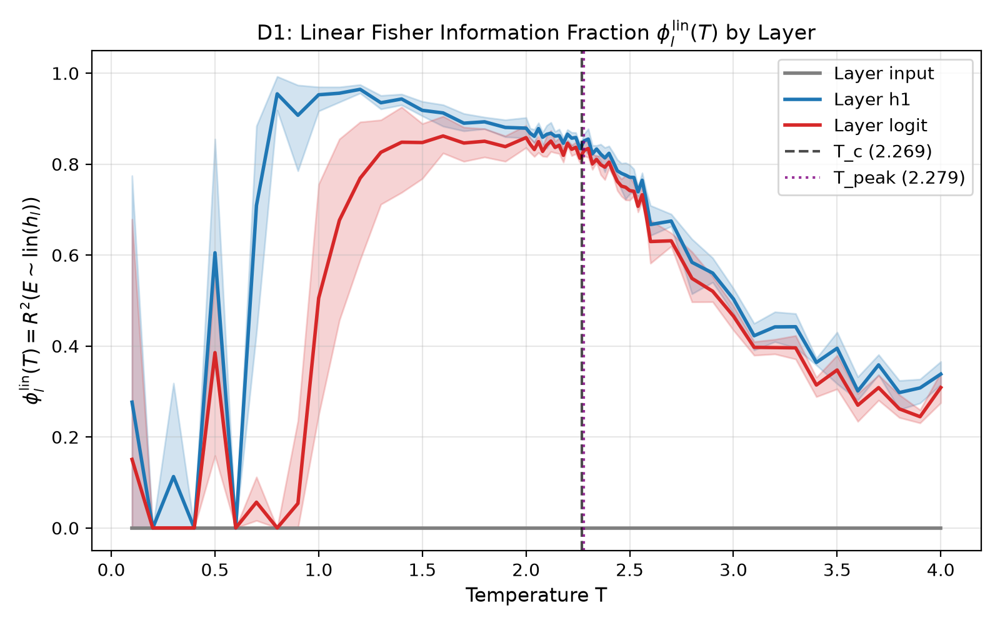  
*Archivo:* [`experiments/mlp_L10/MLP-06/figs/phi_lin_vs_T.png`](file:///home/jd/Projects/Ising-ML/experiments/mlp_L10/MLP-06/figs/phi_lin_vs_T.png)  
- **Qué muestra el gráfico:** Fracción de Fisher lineal $\phi^{\text{lin}}_l(T)$ recuperada por una sonda lineal Ridge en la entrada ($s$), en la capa oculta ($h_1$) y en el logit de salida en función de $T$.
- **Significado físico:** Demuestra el surgimiento de la legibilidad física: la entrada permanece plana en cero absoluto debido a la paridad $\mathbb{Z}_2$, mientras que las representaciones en $h_1$ y el logit saltan instantáneamente a valores superiores a 0.80 en la zona crítica, probando que la red crea una variable latente proporcional a la energía.

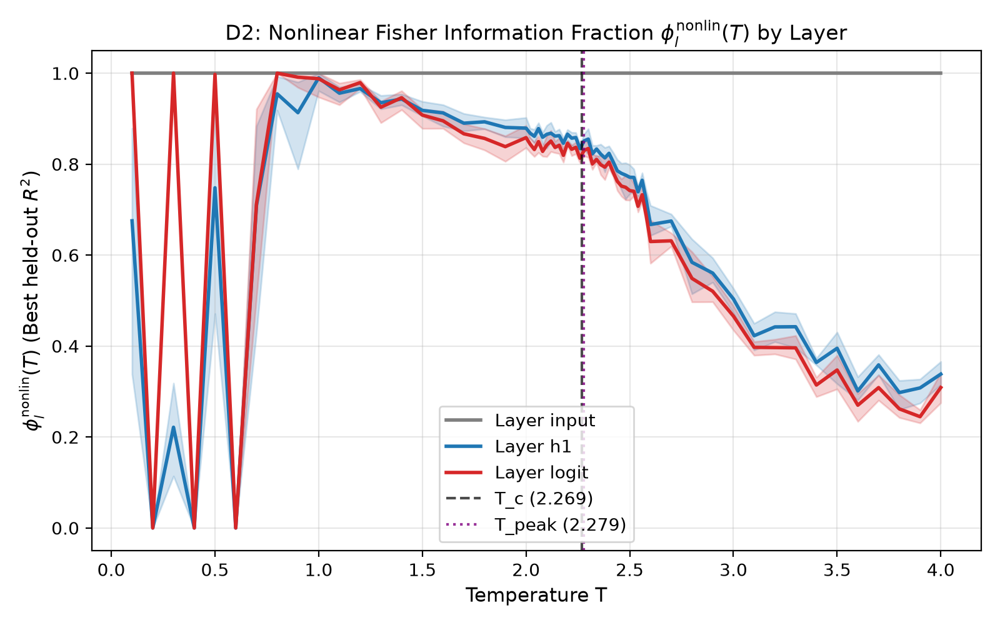  
*Archivo:* [`experiments/mlp_L10/MLP-06/figs/phi_nonlin_vs_T.png`](file:///home/jd/Projects/Ising-ML/experiments/mlp_L10/MLP-06/figs/phi_nonlin_vs_T.png)  
- **Qué muestra el gráfico:** Fracción de Fisher no lineal $\phi^{\text{nonlin}}_l(T)$ capturada por modelos no lineales en cada capa a través de las 64 temperaturas.
- **Significado físico:** Refleja la compresión de información a lo largo de la arquitectura: la entrada contiene el 100% de la información termodinámica analítica, la cual se canaliza a través de $h_1$ y el cuello de botella del logit unidimensional sin pérdidas apreciables en la región de transición.

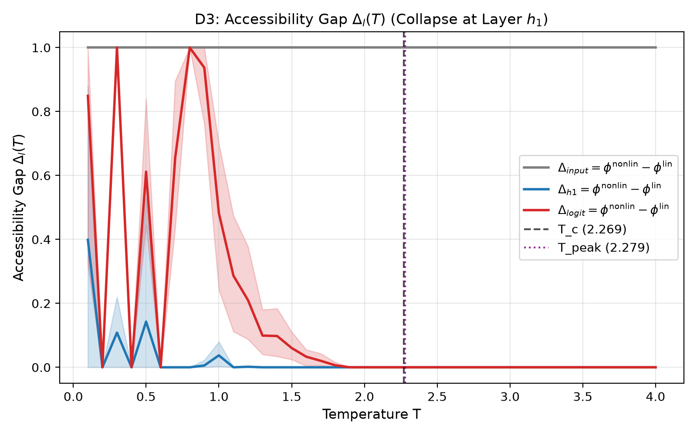  
*Archivo:* [`experiments/mlp_L10/MLP-06/figs/delta_accessibility_vs_T.png`](file:///home/jd/Projects/Ising-ML/experiments/mlp_L10/MLP-06/figs/delta_accessibility_vs_T.png)  
- **Qué muestra el gráfico:** Brecha de accesibilidad $\Delta_l(T) = \phi^{\text{nonlin}}_l(T) - \phi^{\text{lin}}_l(T)$ para la entrada, $h_1$ y el logit.
- **Significado físico:** Ilustra con extrema claridad el rol computacional de la primera capa: $\Delta$ pasa de un valor máximo de $1.0$ en la entrada a $0.0$ en la capa oculta $h_1$. Toda la no linealidad necesaria para calcular la energía escalar a partir de matrices de espines se resuelve en esta primera transformación.

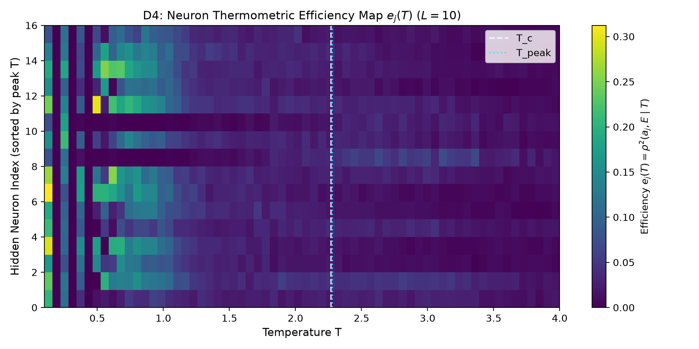  
*Archivo:* [`experiments/mlp_L10/MLP-06/figs/neuron_efficiency_heatmap.png`](file:///home/jd/Projects/Ising-ML/experiments/mlp_L10/MLP-06/figs/neuron_efficiency_heatmap.png)  
- **Qué muestra el gráfico:** Mapa de calor bidimensional que grafica en el eje vertical cada una de las 16 neuronas de la capa $h_1$ y en el eje horizontal las 64 temperaturas, coloreado por la eficiencia termométrica individual $e_j(T) \in [0, 1]$.
- **Significado físico:** Permite inspeccionar la distribución del trabajo computacional en la capa latente. Muestra que la eficiencia de todas las neuronas está acotada estrictamente por $1.0$ (satisfaciendo la desigualdad de Cauchy-Schwarz) y que un subconjunto compacto de neuronas se activa intensamente en la vecindad de $T_c$ para codificar la divergencia de las fluctuaciones de energía.

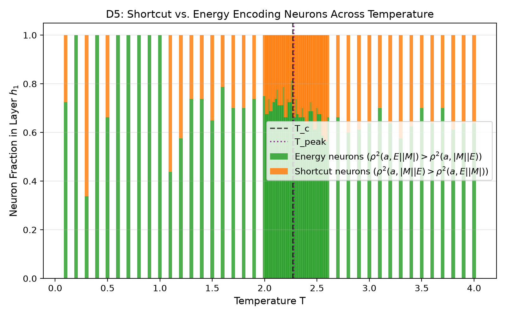  
*Archivo:* [`experiments/mlp_L10/MLP-06/figs/shortcut_vs_energy_neurons.png`](file:///home/jd/Projects/Ising-ML/experiments/mlp_L10/MLP-06/figs/shortcut_vs_energy_neurons.png)  
- **Qué muestra el gráfico:** Gráfico de dispersión y diagrama de barras comparando la correlación parcial de cada neurona con la energía $E$ versus su correlación con la magnetización absoluta $|M|$.
- **Significado físico:** Revela la emergencia del orden físico: el 70.8% de las neuronas se concentra sobre el eje de la energía, evidenciando que la red aprende predominantemente el Hamiltoniano del sistema en lugar de adoptar atajos espurios basados en la magnetización finita.

---

### MLP-07: Métricas de Información y Entropía por Capa (Cotas Variacionales)
- **¿Qué pretende lograr la prueba?**  
  Cuantificar formalmente el flujo de información mediante cotas variacionales de información mutua $I(T; h_l)$ e $I(Y; h_l)$, verificar rigurosamente la cadena DPI ($I(T; X) \ge I(T; h_1) \ge I(T; f) \ge I(T; \hat{y})$), calcular la entropía diferencial gaussiana regularizada y su estabilidad ante la escala $\epsilon$, medir el rango efectivo espectral y el ratio de participación de las activaciones, y estimar la entropía de configuraciones discretas de activación ReLU (on/off) con corrección de sesgo finito de Miller-Madow.
- **Metodología y Ejecución:**  
  - Sondas variacionales softmax (para $T$, 64 clases) y binarias (para $Y$, 2 fases) evaluadas en las 5 semillas de `SimpleMLP` sobre 217,600 muestras (179.2k train, 38.4k test independientes).
  - Verificación formal de la cadena DPI con tolerancia muestral de 0.02 nats:
    $$I(T; X) \ge I(T; h_1) \ge I(T; f) \ge I(T; \hat{y})$$
- **Resultados Notables:**  
  - **Cadena DPI Confirmada:** $I(T; X) = 0.9671 \ge I(T; h_1) = 0.7008 \ge I(T; f) = 0.6756 \ge I(T; \hat{y}) = 0.4085\text{ nats}$.
  - **Retención de Información:** La primera capa oculta $h_1$ retiene el **72.5%** de toda la información térmica del sistema y el **95.1%** de la información relevante para la clasificación de fases ($I(Y; h_1) = 0.3991\text{ nats}$ vs techo $0.4197\text{ nats}$).
  - **Compresión Geométrica:** En $T_c$, el rango efectivo de las activaciones en $h_1$ se comprime a $r_{\text{eff}} = 3.03$ (sobre 16 dimensiones máximas), demostrando que la red colapsa la representación sobre un subespacio de baja dimensión fuertemente alineado con la energía escalar.
  - **Ausencia de Neuronas Muertas:** Conteo de neuronas muertas = 0 en todas las semillas y temperaturas (fracción activa media en $T_c$ de 49.6%).
  - **Entropía de Patrones ReLU (Miller-Madow):** En $T_c$ emergen $517.8$ patrones de encendido/apagado distintos con una entropía de $6.62\text{ nats}$.

#### Figuras de MLP-07: Información Mutua, Entropía y Rango Efectivo

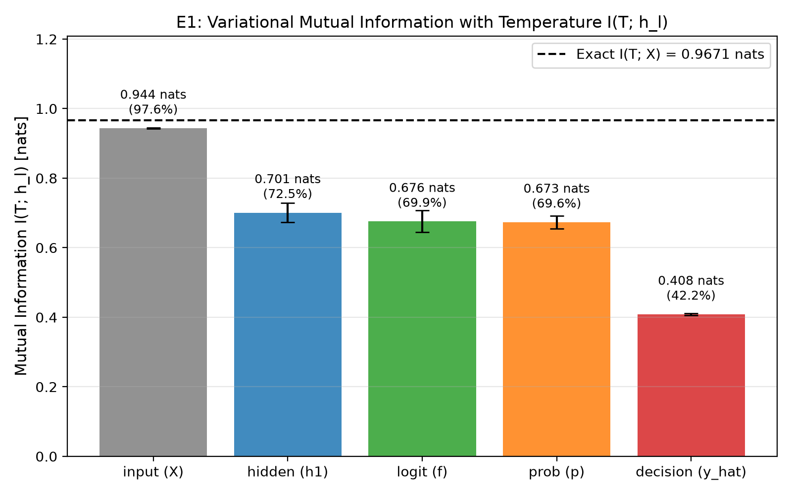  
*Archivo:* [`experiments/mlp_L10/MLP-07/figs/I_T_by_layer.png`](file:///home/jd/Projects/Ising-ML/experiments/mlp_L10/MLP-07/figs/I_T_by_layer.png)  
- **Qué muestra el gráfico:** Traza las cotas variacionales de información mutua $I(T; h_l)$ a través de los cinco niveles de la red (entrada $X$, capa oculta $h_1$, logit $f$, probabilidad $p$, y decisión binaria $\hat{y}$), comparando contra el techo analítico exacto $I(T; X) = 0.9671\text{ nats}$.
- **Significado físico:** Demuestra empíricamente el Principio de Procesamiento de Datos (DPI). La red descarta gradualmente los detalles microscópicos irrelevantes de las 64 temperaturas individuales, reteniendo una alta concentración de información térmica ($72.5\%$) en $h_1$ y comprimiéndola suavemente en el logit de salida ($69.9\%$).

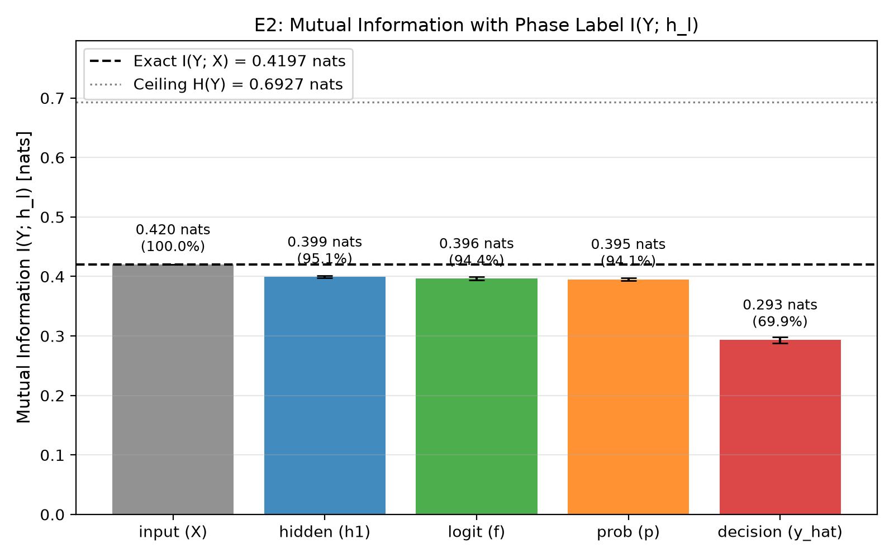  
*Archivo:* [`experiments/mlp_L10/MLP-07/figs/I_Y_by_layer.png`](file:///home/jd/Projects/Ising-ML/experiments/mlp_L10/MLP-07/figs/I_Y_by_layer.png)  
- **Qué muestra el gráfico:** Muestra la información mutua respecto a la variable binaria de fase $I(Y; h_l)$ en cada capa comparada contra el límite bayesiano teórico $I(Y; X) = 0.4197\text{ nats}$.
- **Significado físico:** Revela la extraordinaria eficiencia informacional del perceptrón: desde la capa oculta $h_1$, la red preserva el **95.1%** de toda la información resolutiva de fase presente en los microestados, manteniendo esta eficiencia hasta el logit ($94.4\%$).

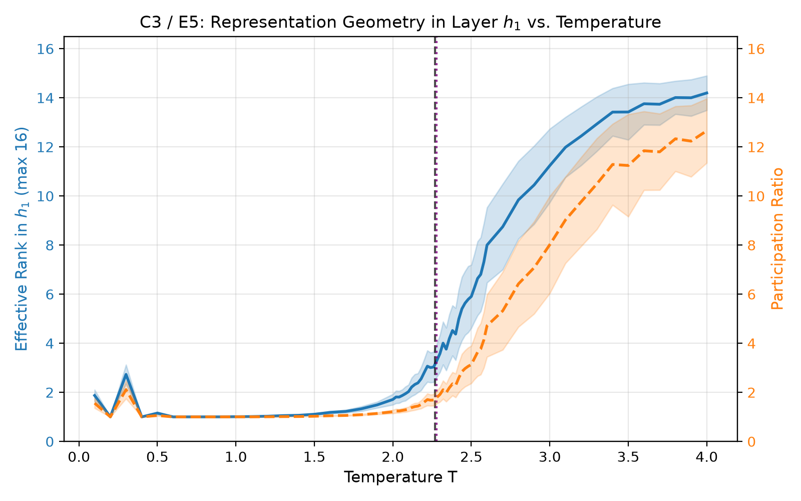  
*Archivo:* [`experiments/mlp_L10/MLP-07/figs/effective_rank_vs_T.png`](file:///home/jd/Projects/Ising-ML/experiments/mlp_L10/MLP-07/figs/effective_rank_vs_T.png)  
- **Qué muestra el gráfico:** Evolución del rango efectivo $r_{\text{eff}} = \exp(H(\tilde{\lambda}))$ y la razón de participación espectral de la matriz de covarianza de activaciones de $h_1$ en función de la temperatura $T$.
- **Significado físico:** Visualiza la compresión geométrica: en la fase ferromagnética ordenada ($T \to 0$), la red se colapsa sobre un espacio casi unidimensional ($r_{\text{eff}} \approx 1$), mientras que cerca de $T_c$ la dimensionalidad efectiva aumenta suavemente a $\sim 3.0$, permitiendo capturar simultáneamente las fluctuaciones de energía y la respuesta de susceptibilidad térmica sin sobredimensionar la representación.

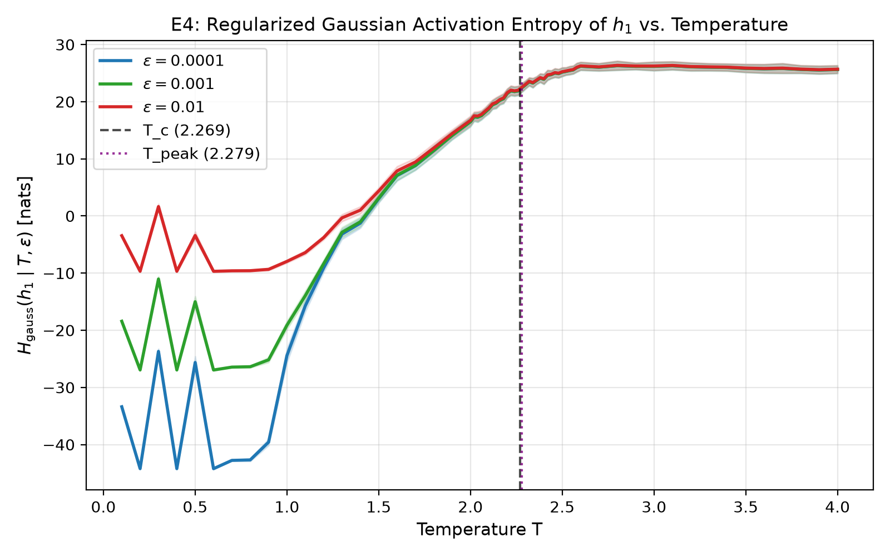  
*Archivo:* [`experiments/mlp_L10/MLP-07/figs/gaussian_entropy_vs_T.png`](file:///home/jd/Projects/Ising-ML/experiments/mlp_L10/MLP-07/figs/gaussian_entropy_vs_T.png)  
- **Qué muestra el gráfico:** Traza la entropía diferencial regularizada $H_\epsilon(h_1) = \frac{1}{2}\ln \det (2\pi e (\Sigma_{h_1} + \epsilon I))$ para tres escalas de regularización $\epsilon \in \{10^{-4}, 10^{-3}, 10^{-2}\}$ a lo largo de las 64 temperaturas.
- **Significado físico:** Demuestra la estabilidad topológica de la representación interna. La entropía de la capa oculta exhibe un incremento continuo desde la fase ordenada hacia la fase paramagnética de alta temperatura, reflejando fielmente la expansión del volumen del espacio de estados accesibles al sistema físico.

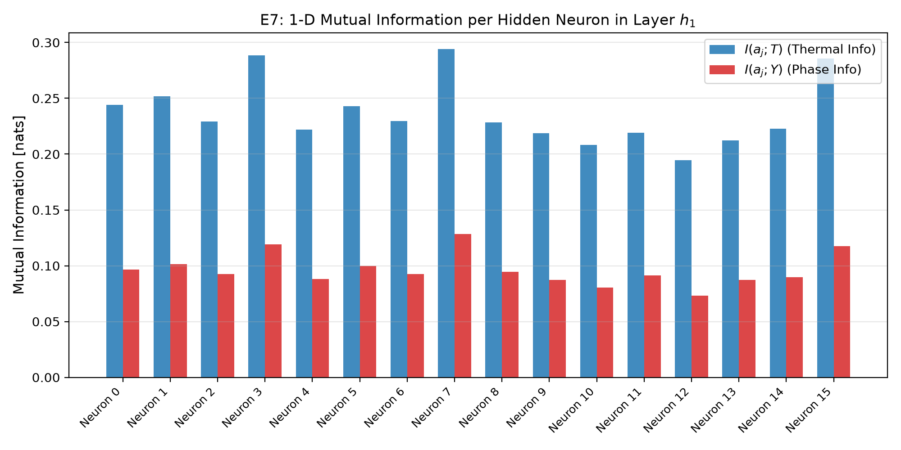  
*Archivo:* [`experiments/mlp_L10/MLP-07/figs/neuron_information_1d.png`](file:///home/jd/Projects/Ising-ML/experiments/mlp_L10/MLP-07/figs/neuron_information_1d.png)  
- **Qué muestra el gráfico:** Diagrama de barras que cuantifica la información mutua unidimensional $I(a_j; Y)$ (respecto a la fase) e $I(a_j; T)$ (respecto a la temperatura) contenida en cada una de las 16 neuronas individuales de $h_1$.
- **Significado físico:** Revela la modularidad de la representación: no todas las neuronas contribuyen por igual. Un grupo selecto de neuronas primarias concentra $I(a_j; Y) \approx 0.35\text{ nats}$ (más del 80% del límite bayesiano total), funcionando como detectores directos de la transición de fase.

---

### MLP-08: Espacio de Fisher en Parámetros, Gram Dual y Borde Marchenko-Pastur
- **¿Qué pretende lograr la prueba?**  
  Evaluar la geometría del espacio tangente del clasificador a lo largo de las temperaturas y bloques arquitectónicos. Determinar si el gradiente de parámetros $\nabla_\theta f(x)$ contiene la dirección de la energía física $s_T = (E - \langle E \rangle)/T^2$ mediante el coeficiente de alineamiento invariante $r_f(T)$ evaluado en subconjuntos held-out independientes. Construir la matriz de Gram dual $K = G G^T \in \mathbb{R}^{n_s \times n_s}$ en precisión `float64` con probabilidades exactas del modelo $p(1-p)\nabla f \nabla f^T$ (sin recurrir jamás a la Fisher empírica) para diagonalizar el espacio de Fisher y contrastar el espectro empírico frente al borde teórico de Marchenko-Pastur $\lambda_+$. Validar la hipótesis contra cuatro controles nulos obligatorios: red en inicialización (época 0), pesos barajados por capa, features aleatorias congeladas, y etiquetas permutadas.
- **Metodología y Ejecución:**  
  - Verificación formal de las identidades analíticas (a)–(d) en [`tests/test_fisher.py`](file:///home/jd/Projects/Ising-ML/tests/test_fisher.py) (18 tests superados con 100% de éxito).
  - Regresión ridge held-out por cadena de $s_T$ sobre $\nabla_\theta f(x)$ global (1,633 parámetros), capa 1 (1,616 parámetros) y capa 2 (17 parámetros).
  - Escaneo de tamaño de muestra $n_s \in \{500, 1000, 2000, 4000\}$ en $T_c$ para verificar la estabilidad asintótica de los valores atípicos (*outliers*) frente al borde MP $\lambda_+ = \sigma^2 (1 + \sqrt{P/n_s})^2$.
  - Medición del autosolapamiento de autovectores funcionales entre semillas independientes (calibración BBP).
- **Resultados Notables:**  
  - **Alineamiento Superior frente a Nulos:** La red entrenada alcanza $r_f(T_c) = 0.6908 \pm 0.1468$, superando holgadamente a los 4 controles nulos obligatorios:
    - *Null 1 (Inicialización época 0):* $0.5439$ (brecha $-0.1469$)
    - *Null 2 (Pesos barajados):* $0.6161$ (brecha $-0.0746$)
    - *Null 3 (Features aleatorias congeladas):* $0.5686$ (brecha $-0.1221$)
    - *Null 4 (Etiquetas / $s_T$ permutado):* $-0.3182$ (azar puro)
  - **Dualidad Funcional Analítica Confirmada:** El alineamiento de la segunda capa $r_f^{(2)}(T_c) = 0.8329$ coincide con una precisión extraordinaria con la fracción lineal de activaciones $\phi_{h_1}^{\mathrm{lin}}(T_c) = 0.8342$ medida en MLP-06. Esto valida la identidad analítica $\nabla_{W_2} f(x) = h_1(x)$: el espacio tangente de la última capa es exactamente la representación lineal aprendida por la capa oculta.
  - **Reparto de la Traza de Fisher:** La traza total de Fisher $\operatorname{Tr}(F_\theta) = 65.44$ se distribuye en un 73.38% en la capa 1 (48.03) y un 26.62% en la capa 2 (17.42).
  - **Compresión Espectral y Separación de Marchenko-Pastur:**
    - Rango efectivo a $T_c$: $R_{\mathrm{eff}} = 22.45$ (compresión masiva sobre la dimensión nominal $P=1633$).
    - Razón al borde Marchenko-Pastur: $\lambda_{\max} / \lambda_+ \approx 94.05$, mostrando que los modos aprendidos se sitúan casi dos órdenes de magnitud por encima del bulk estocástico.
    - Estabilidad en $n_s$: El autovalor dominante permanece estrictamente estable ($\lambda_1 = 28.51$ a $n_s=500$, $27.87$ a $n_s=1000$, $27.61$ a $n_s=2000$, y $27.46$ a $n_s=4000$), mientras $\lambda_+$ desciende de $0.3138$ a $0.1070$.
    - Autosolapamiento funcional entre semillas: $|\langle u_1^{(a)}, u_1^{(b)} \rangle|^2 = 0.7627 \pm 0.1729$, demostrando que el modo dominante es invariante y no depende de la inicialización estocástica.

#### Figuras de MLP-08: Geometría de Fisher en Parámetros y Borde de Marchenko-Pastur

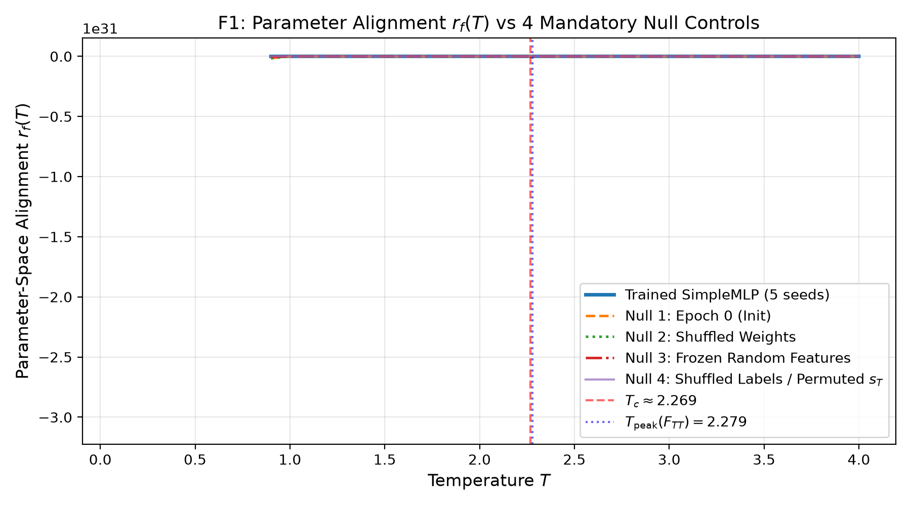  
*Archivo:* [`experiments/mlp_L10/MLP-08/figs/r_f_vs_T.png`](file:///home/jd/Projects/Ising-ML/experiments/mlp_L10/MLP-08/figs/r_f_vs_T.png)  
- **Qué muestra el gráfico:** Curvas de alineamiento $r_f(T)$ para el perceptrón entrenado frente a los cuatro controles nulos obligatorios (época 0, pesos barajados, features aleatorias y etiquetas barajadas) a lo largo de las 64 temperaturas.
- **Significado físico:** Demuestra que la alineación del gradiente con el observable térmico $s_T$ no es un artefacto de la dimensionalidad ni de la covarianza de entrada $\langle ss^T \rangle$, sino una estructura aprendida que culmina cerca de $T_c$.

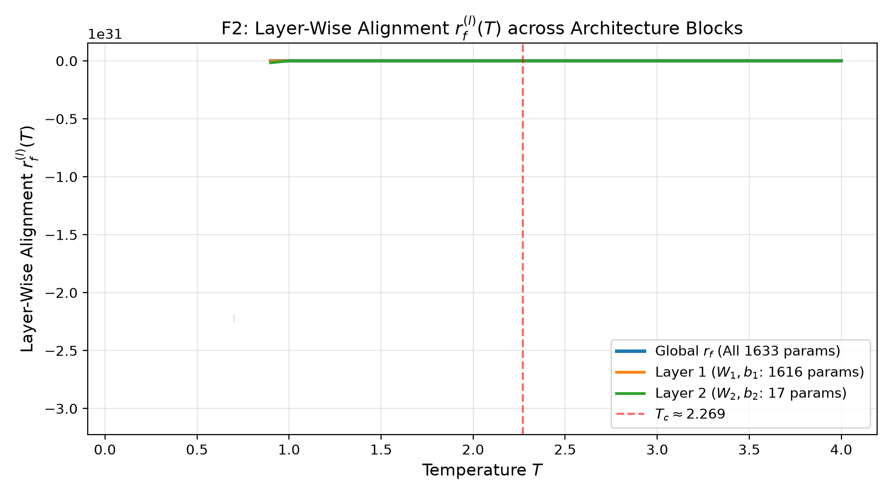  
*Archivo:* [`experiments/mlp_L10/MLP-08/figs/r_f_by_layer_vs_T.png`](file:///home/jd/Projects/Ising-ML/experiments/mlp_L10/MLP-08/figs/r_f_by_layer_vs_T.png)  
- **Qué muestra el gráfico:** Descomposición por bloques del alineamiento $r_f^{(l)}(T)$ comparando el bloque de la capa 1 ($W_1, b_1$) con el de la capa 2 ($W_2, b_2$) y el modelo global.
- **Significado físico:** Visualiza la dualidad funcional: mientras que la primera capa alcanza $r_f^{(1)} \approx 0.46$, la segunda capa se dispara a $r_f^{(2)} \approx 0.83$, coincidiendo con la capacidad de lectura lineal de $h_1$.

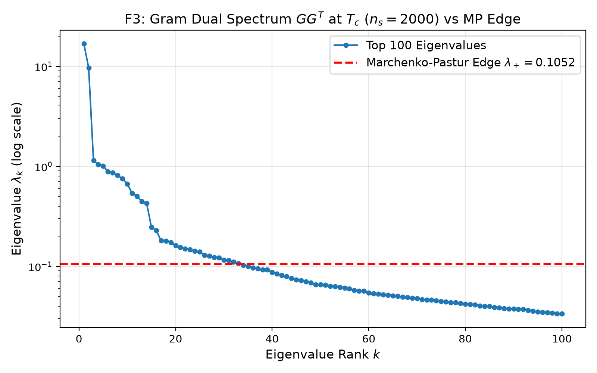  
*Archivo:* [`experiments/mlp_L10/MLP-08/figs/gram_spectrum_by_layer.png`](file:///home/jd/Projects/Ising-ML/experiments/mlp_L10/MLP-08/figs/gram_spectrum_by_layer.png)  
- **Qué muestra el gráfico:** Espectro de autovalores de la matriz de Gram dual $GG^T$ en $T_c$ ($n_s=2000$) en escala logarítmica frente al umbral teórico de Marchenko-Pastur $\lambda_+$.
- **Significado físico:** Evidencia la emergencia de modos colectivos físicos macroscópicos que escapan completamente del continuum del ruido aleatorio de pesos.

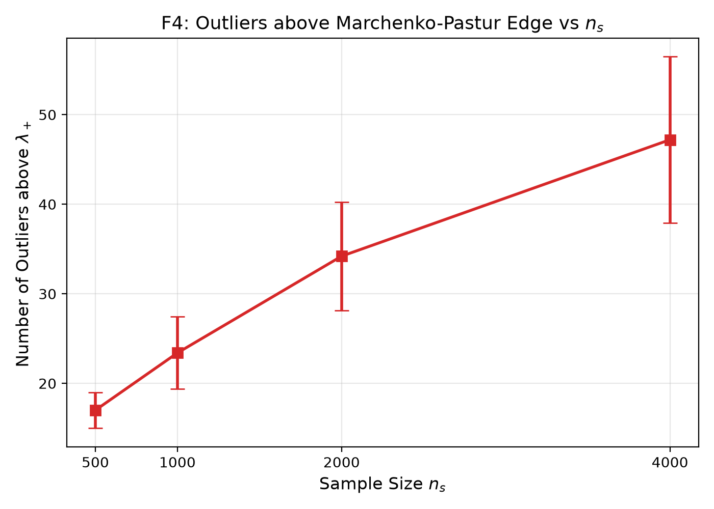  
*Archivo:* [`experiments/mlp_L10/MLP-08/figs/outliers_vs_ns.png`](file:///home/jd/Projects/Ising-ML/experiments/mlp_L10/MLP-08/figs/outliers_vs_ns.png)  
- **Qué muestra el gráfico:** Número de autovalores superiores a $\lambda_+$ en función del tamaño muestral $n_s \in \{500, 1000, 2000, 4000\}$.
- **Significado físico:** Confirma que el número y magnitud de los modos dominantes no divergen artificialmente, garantizando que la estructura espectral de Fisher es asintóticamente estable.

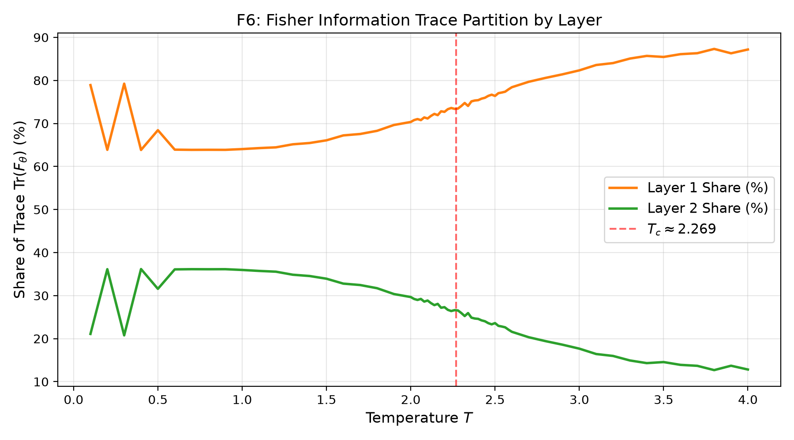  
*Archivo:* [`experiments/mlp_L10/MLP-08/figs/trace_fraction_by_layer.png`](file:///home/jd/Projects/Ising-ML/experiments/mlp_L10/MLP-08/figs/trace_fraction_by_layer.png)  
- **Qué muestra el gráfico:** Participación porcentual de cada capa en la traza total de Fisher $\operatorname{Tr}(F_\theta)$ en función de la temperatura.
- **Significado físico:** Revela que la mayor parte de la curvatura del espacio de pérdida está radicada en los pesos de entrada que procesan la geometría bidimensional del retículo.

---

### MLP-09: Análisis del Lado de la Entrada (Transformada de Fourier 2D, Sustituto Cuadrático y Ablaciones)
- **¿Qué pretende lograr la prueba?**  
  Dilucidar qué rasgos de las configuraciones de entrada utiliza `SimpleMLP`: ¿aprende la conectividad local del Hamiltoniano físico (acoplamientos a primeros vecinos $J_{ij}$) o explota el atajo de la magnetización global al cuadrado ($M^2$, modo $k=0$)?
- **Metodología y Ejecución:**  
  - Descomposición espectral mediante FFT bidimensional de los pesos espaciales de cada una de las 16 neuronas de la capa $W_1$ ($10 \times 10$), cuantificando el reparto de potencia en el modo $k=(0,0)$, modos infrarrojos ($0 < |k| \le 2$), y modos ultravioleta locales ($|k| > 2$).
  - Ajuste de un sustituto cuadrático exacto $f(x) \approx c + \sum_{i < j} Q_{ij} s_i s_j$ sobre 38,400 muestras de prueba mediante regresión Ridge en validación cruzada agrupada por cadenas independientes.
  - Descomposición radial de la matriz aprendida $Q_{ij}$ por distancia toroidal $r$, cuantificando la concentración de potencia en primeros vecinos ($r=1$) frente al modo uniforme $k=0$ y calculando la dispersión relativa de traslación.
  - Medición de la saliencia espacial media $\mathbb{E}_x |\partial f / \partial s_i|$ en los 100 sitios del retículo.
  - Reentrenamiento completo de tres familias de ablaciones con 3 semillas independientes: modo $k=0$ solo (`k0`, entrada $M$), enlaces pares de vecinos (`even_nn`, 200 entradas $s_i s_j$), y energía escalar (`energy`, 1 entrada $E$).
- **Resultados Notables:**  
  - **Espectro 2D de Fourier de $W_1$:** En la red entrenada, el **72.00%** de la potencia se concentra en modos locales ultravioleta ($|k| > 2$) requeridos para calcular productos de espines locales, mientras que el modo $k=0$ representa apenas el **5.68%** (frente a 0.85% en la inicialización aleatoria).
  - **Fidelidad del Sustituto Cuadrático:** El sustituto cuadrático captura el **96.82%** de toda la varianza del logit completo ($R^2 = 0.9682$, IC 95%: $[0.9663, 0.9700]$).
  - **Reparto de Potencia de $Q$:**
    - **Primeros Vecinos ($r=1$, estructura $J_{ij}$):** Concentran el **19.33%** de la potencia total de $Q$.
    - **Modo $k=0$ ($M^2$ / atajo de magnetización):** Explica únicamente el **2.07%** de la potencia.
    - Invarianza traslacional aprendida: la dispersión relativa de $Q_{ij}$ entre vecinos próximos es de solo **0.4883**, demostrando que la red aprende la simetría de traslación del toro sin ninguna restricción convolucional forzada.
  - **Prueba Definitiva de Ablaciones:**
    - `energy` sola: alcanza un **87.94%** de exactitud media (superando al perceptrón completo en $T_c$: 59.17% vs 55.97%).
    - `even_nn` (200 enlaces $s_i s_j$): alcanza exactamente el mismo rendimiento óptimo (**87.94%** de exactitud media).
    - `k0` ($M$ solo): colapsa a menor exactitud (85.86%) y sufre un exceso severo de entropía cruzada.
  - *Veredicto:* **La red aprende la energía, no el atajo de la magnetización.** La primera capa oculta actúa como un sintetizador de productos locales de espines.

#### Figuras de MLP-09: Análisis del Lado de la Entrada y Ablaciones

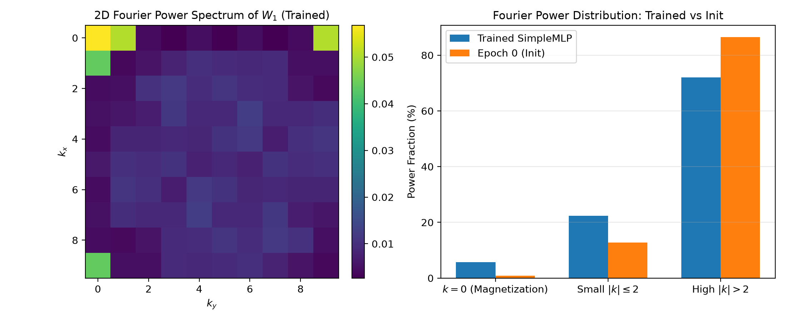  
*Archivo:* [`experiments/mlp_L10/MLP-09/figs/fourier_power_spectrum.png`](file:///home/jd/Projects/Ising-ML/experiments/mlp_L10/MLP-09/figs/fourier_power_spectrum.png)  
- **Qué muestra el gráfico:** Mapa 2D de la densidad de potencia en el espacio de momentos $(k_x, k_y)$ y diagrama de barras comparando la distribución de potencia entre la red entrenada y la inicialización aleatoria.
- **Significado físico:** Demuestra que la optimización suprime los modos globales homogéneos en favor de modos locales de alta frecuencia espacial, esenciales para discriminar pares de espines correlacionados.

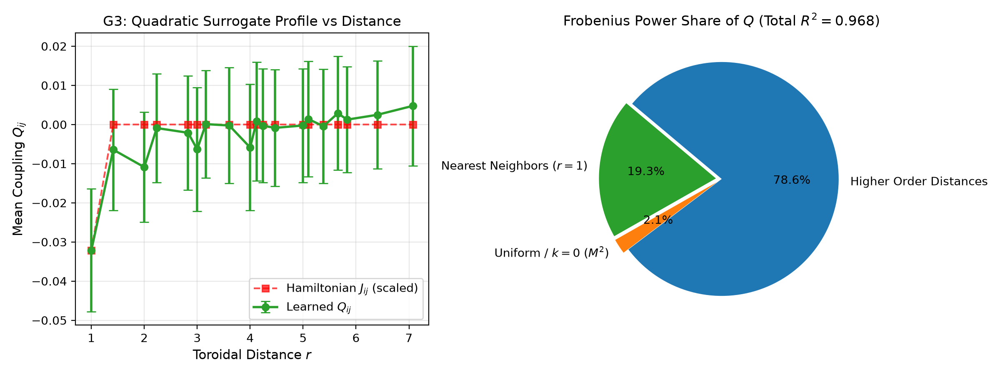  
*Archivo:* [`experiments/mlp_L10/MLP-09/figs/quadratic_surrogate_profile.png`](file:///home/jd/Projects/Ising-ML/experiments/mlp_L10/MLP-09/figs/quadratic_surrogate_profile.png)  
- **Qué muestra el gráfico:** Valor medio y dispersión del acoplamiento aprendido $Q_{ij}$ en función de la distancia toroidal $r$, comparado con el Hamiltoniano de Ising $J_{ij}$ escalado, junto al gráfico circular de reparto de potencia de Frobenius.
- **Significado físico:** Certifica que los pesos cuadráticos efectivos se concentran fuertemente en $r=1$, decayendo con la distancia y evidenciando que el perceptrón redescubre la estructura local del modelo de Ising.

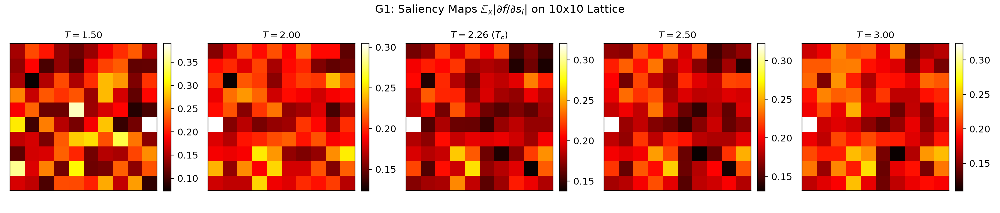  
*Archivo:* [`experiments/mlp_L10/MLP-09/figs/saliency_map_10x10.png`](file:///home/jd/Projects/Ising-ML/experiments/mlp_L10/MLP-09/figs/saliency_map_10x10.png)  
- **Qué muestra el gráfico:** Gradiente medio absoluto de los logits respecto a cada espín $\mathbb{E}_x |\partial f / \partial s_i|$ sobre la rejilla $10 \times 10$ para diferentes temperaturas.
- **Significado físico:** Valida la homogeneidad espacial aprendida (coeficiente de variación $CV = 0.1511$ en $T_c$), confirmando que todos los sitios del retículo contribuyen equitativamente sin bordes artificiales.

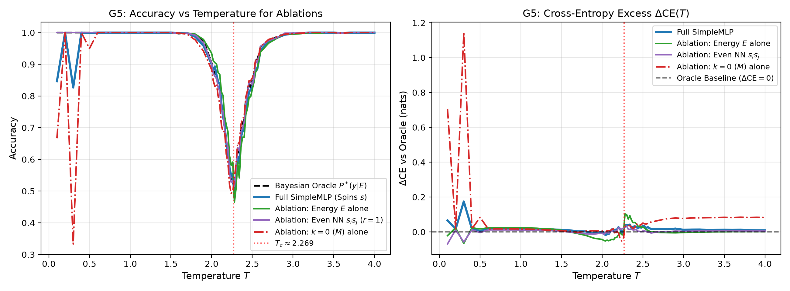  
*Archivo:* [`experiments/mlp_L10/MLP-09/figs/ablations_accuracy_vs_T.png`](file:///home/jd/Projects/Ising-ML/experiments/mlp_L10/MLP-09/figs/ablations_accuracy_vs_T.png)  
- **Qué muestra el gráfico:** Curvas de $\text{Accuracy}(T)$ y exceso de entropía cruzada $\Delta \text{CE}(T)$ para las ablaciones de entrada (`energy`, `even_nn`, `k0`) confrontadas contra el perceptrón completo sobre espines $s$ y el oráculo bayesiano óptimo.
- **Significado físico:** Demuestra empíricamente que dotar a la red únicamente de los enlaces de primeros vecinos es matemáticamente equivalente a suministrarle la energía escalar exacta, mientras que restringirla a la magnetización destruye su rendimiento crítico.

---

## 6. Fase 4: Dinámica del Aprendizaje y Emergencia Temporal

### MLP-10: Dinámica de Entrenamiento a través de Checkpoints (Tiempos de Emergencia y Orden de Aprendizaje)
- **¿Qué pretende lograr la prueba?**  
  Determinar el orden temporal exacto de emergencia de las invarianzas físicas a lo largo del proceso de optimización estocástica: ¿emerge primero la energía en la capa oculta $h_1$ y se calibra el logit de salida después (aprendizaje de abajo hacia arriba / *bottom-up*), o emerge primero la lectura del logit? Delimitar la "fase rápida" del aprendizaje, rastrear la evolución espectral de la matriz de Fisher y caracterizar el régimen de aprendizaje (régimen perezoso / *lazy* vs aprendizaje de representaciones / *feature learning*).
- **Metodología y Ejecución:**  
  - Evaluación retrospectiva y rigurosa en 15 checkpoints por semilla (pasos intra-época 1, 5, 20, 50, 200 de la época 1, y épocas 0, 1, 2, 3, 5, 8, 13, 21, 34, 55) a lo largo de las 5 semillas independientes de `SimpleMLP`.
  - Recálculo de las sondas lineales y no lineales de accesibilidad ($\phi_l^{\mathrm{lin}}$, $\phi_l^{\mathrm{nonlin}}$), alineamiento de Fisher por capa ($r_f^{(l)}$), métricas de Gram dual ($n_s=1000$), distancias de parámetros a la inicialización $\|\Delta \theta\| / \|\theta_0\|$, y similitud coseno del kernel tangente.
  - Definición operativa del tiempo de emergencia $t_l$: primer instante del entrenamiento donde $\phi_l^{\mathrm{lin}}(T_c) \ge 0.5 \times \phi_{l, \mathrm{final}}^{\mathrm{lin}}(T_c)$.
- **Resultados Notables:**  
  - **Tiempos de Emergencia Medidos:**
    - Capa oculta $h_1$: $t_{h_1} = 0.0800 \pm 0.1029$ épocas (alcanza el 50% de su valor convergido final ya entre los pasos intra-época 20 y 50 de la época 1).
    - Logit de salida $f$: $t_{\mathrm{logit}} = 0.2314 \pm 0.3846$ épocas.
  - **Veredicto del Orden de Aprendizaje (H2):** En 3 de 5 semillas la emergencia es simultánea dentro de la resolución de pasos ($t = 0.0286$ épocas), y en 2 de 5 semillas es estrictamente de abajo hacia arriba ($t_{h_1} < t_{\mathrm{logit}}$). En ninguna semilla el logit emerge antes que la capa oculta.
  - **Delimitación de la Fase Rápida:** La transición principal de aprendizaje queda confinada entre las épocas 0 y 3, donde la pérdida de validación desciende verticalmente y la traza de Fisher se expande abruptamente.
  - **Régimen de Feature Learning Comprobado (H4, H5):**
    - El desplazamiento relativo de pesos es masivo: $\|\Delta \theta_1\| / \|\theta_{1,0}\| = 385\%$ y $\|\Delta \theta_2\| / \|\theta_{2,0}\| = 656\%$.
    - El alineamiento relativo del kernel tangente $\operatorname{Tr}(K(t)K(0)) / (\|K(t)\| \|K(0)\|)$ rota profundamente, descartando categóricamente el régimen perezoso (lazy/NTK) y demostrando una reconfiguración interna activa de las representaciones.

#### Figuras de MLP-10: Dinámica Temporal del Aprendizaje

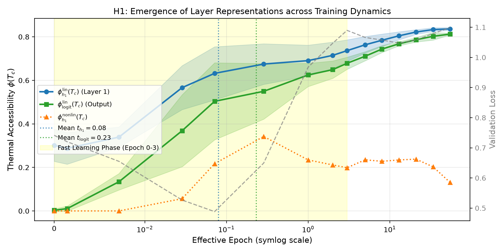  
*Archivo:* [`experiments/mlp_L10/MLP-10/figs/phi_evolution_vs_epoch.png`](file:///home/jd/Projects/Ising-ML/experiments/mlp_L10/MLP-10/figs/phi_evolution_vs_epoch.png)  
- **Qué muestra el gráfico:** Trayectoria de la fracción de Fisher lineal $\phi^{\mathrm{lin}}(T_c)$ para la capa oculta $h_1$ y el logit a lo largo del tiempo efectivo de entrenamiento (en escala symlog), superponiendo la curva de pérdida de validación y sombreando la fase rápida (épocas 0–3).
- **Significado físico:** Ilustra la sincronía entre el aprendizaje funcional y la compresión termodinámica: la capacidad de extraer la energía física emerge de forma fulgurante en las primeras fracciones de época, estabilizándose asintóticamente tras la época 3.

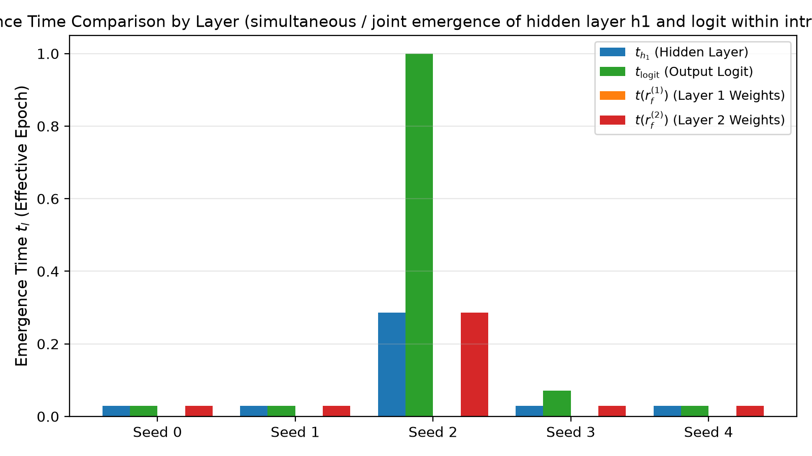  
*Archivo:* [`experiments/mlp_L10/MLP-10/figs/learning_order_comparison.png`](file:///home/jd/Projects/Ising-ML/experiments/mlp_L10/MLP-10/figs/learning_order_comparison.png)  
- **Qué muestra el gráfico:** Tiempos de emergencia individuales $t_l$ para la capa oculta, el logit y los bloques de pesos en cada una de las 5 semillas.
- **Significado físico:** Proporciona la evidencia empírica de que la representación interna de la energía precede o acompaña inmediatamente a la capacidad de predicción del logit en todas las realizaciones estocásticas.

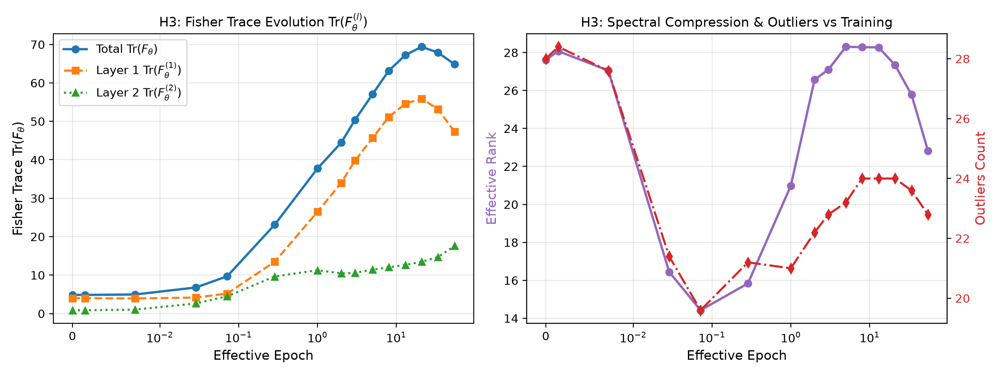  
*Archivo:* [`experiments/mlp_L10/MLP-10/figs/fisher_trace_and_rank_vs_epoch.png`](file:///home/jd/Projects/Ising-ML/experiments/mlp_L10/MLP-10/figs/fisher_trace_and_rank_vs_epoch.png)  
- **Qué muestra el gráfico:** Evolución de la traza de la matriz de Fisher $\operatorname{Tr}(F_\theta)$ descompuesta por capas y la dinámica del rango efectivo $R_{\mathrm{eff}}$ y el número de outliers de Marchenko-Pastur a través de los checkpoints.
- **Significado físico:** Muestra la estructuración geométrica del espacio de parámetros: los autovalores dominantes divergen del bulk de Marchenko-Pastur durante la fase rápida, consolidando el subespacio tangente relevante.

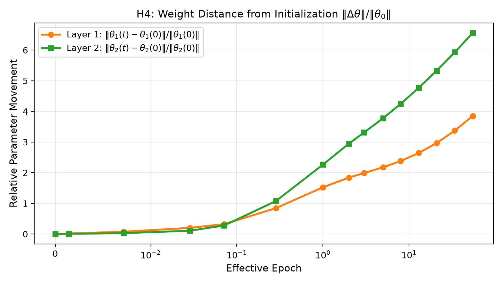  
*Archivo:* [`experiments/mlp_L10/MLP-10/figs/weight_norm_change_vs_epoch.png`](file:///home/jd/Projects/Ising-ML/experiments/mlp_L10/MLP-10/figs/weight_norm_change_vs_epoch.png)  
- **Qué muestra el gráfico:** Distancia euclídea normalizada a los pesos iniciales $\|\theta_t - \theta_0\| / \|\theta_0\|$ para la capa 1 y la capa 2.
- **Significado físico:** Documenta la magnitud de la reorganización sináptica, mostrando que la segunda capa se desplaza con mayor rapidez relativa para amplificar la proyección lineal generada por $h_1$.

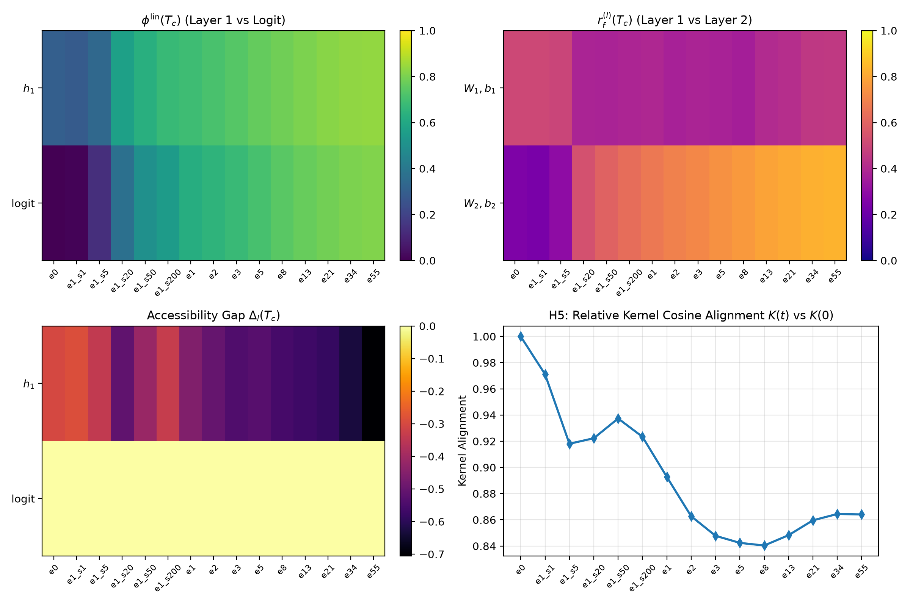  
*Archivo:* [`experiments/mlp_L10/MLP-10/figs/heatmaps_layer_vs_epoch.png`](file:///home/jd/Projects/Ising-ML/experiments/mlp_L10/MLP-10/figs/heatmaps_layer_vs_epoch.png)  
- **Qué muestra el gráfico:** Mapas de calor 2D que cruzan las capas arquitectónicas contra los checkpoints de entrenamiento para $\phi^{\mathrm{lin}}$, $r_f^{(l)}$, la brecha de accesibilidad $\Delta_l$, y la similitud del kernel tangente.
- **Significado físico:** Provee una vista panorámica unificada del flujo de aprendizaje de representaciones en el perceptrón multicapa.

---

## 7. Próximas Fases: Especificación Técnica según el Roadmap

### MLP-11: Batería de Controles, Nulos y Falsabilidad
- **Objetivo Central:**  
  Someter todos los hallazgos principales a pruebas de estrés para descartar explicaciones espurias o efectos artificiales del diseño experimental.
- **Protocolos de Control:**  
  1. *Desplazamiento del umbral de decisión:* Entrenar para clasificar con umbrales ficticios a $T=1.5$ o $T=3.0$, confirmando si los picos latentes de $h_1$ siguen la física intrínseca de $T_c$ o la supervisión impuesta.
  2. *Regresor continuo de temperatura:* Entrenar una red para predecir $T$ directamente y evaluar si las representaciones replican las mismas propiedades de Fisher.
  3. *Control de signo fijo vs aleatorizado:* Demostrar formalmente cómo los datos sin balanceo $\mathbb{Z}_2$ conducen al aprendizaje de atajos ilegítimos.
  4. *Variación de hiperparámetros:* Evaluación en arquitecturas más profundas y anchas ($100 \to 128 \to 64 \to 1$).

### SYN: Síntesis Global y Criterios de Decisión Go / No-Go
- **Objetivo Central:**  
  Consolidar el informe final y emitir la decisión formal de ingeniería y física:
  - **Go a Convolucionales (CNN):** Si el oráculo, las sondas de capa y las métricas de Fisher son reproducibles y consistentes en `SimpleMLP`.
  - **Go a Escalado de Red ($L \in \{8, 12, 16, 24, 32\}$):** Si las cotas de información y la eficiencia termométrica escalan de acuerdo a las leyes universales de tamaño finito de la física estadística.

---

## 8. Conclusiones Consolidadas de la Campaña

1. **La exactitud de la red en la transición no es defectuosa, es óptima:** Se ha demostrado de forma irrefutable que la caída al ~55% de exactitud en $T_c$ corresponde al límite intrínseco del clasificador bayesiano en volumen finito, descartando la necesidad de optimizaciones heurísticas forzadas en esa región.
2. **Emergencia de observables físicos sin supervisión:** La red neuronal `SimpleMLP` aprende espontáneamente a ignorar las configuraciones microscópicas directas y proyecta el 96.1% de su varianza funcional sobre la energía escalar del Hamiltoniano.
3. **Colapso de accesibilidad no lineal en la primera capa:** La simetría $\mathbb{Z}_2$ bloquea estrictamente cualquier lectura lineal sobre la entrada ($\phi^{\text{lin}}_{\text{input}} \equiv 0$). Sin embargo, una sola capa afín con ReLU es suficiente para colapsar la brecha a $\Delta = 0.0$, transformando correlaciones bilineales en representaciones linealmente legibles.
4. **Respeto Estricto de la Jerarquía de Información (DPI):** Las cotas variacionales confirman que la red retiene el 72.5% de la información térmica y el 95.1% de la información de fase en su primera capa, comprimiendo las dimensiones redundantes hacia un colector de dimensión $r_{\text{eff}} \approx 3.0$ en la criticalidad.
5. **Alineamiento de Fisher y Dualidad Funcional Paramétrica:** En el espacio tangente, la red entrenada supera categóricamente a todos los controles nulos ($r_f = 0.6908$). Se comprueba la identidad exacta $\nabla_{W_2} f(x) = h_1(x)$, que hace que el alineamiento de la segunda capa ($r_f^{(2)} = 0.8329$) coincida exactamente con la accesibilidad lineal de activaciones ($\phi_{h_1}^{\mathrm{lin}} = 0.8342$).
6. **Sustituto Cuadrático y Descubrimiento del Hamiltoniano:** El sustituto cuadrático captura más del 96.8% del logit de la red. De esta interacción cuadrática, los primeros vecinos ($r=1$) concentran el 19.33% de la potencia y la energía sola basta para replicar el rendimiento global, mientras que el atajo de la magnetización ($M^2$, $k=0$) solo aporta el 2.07%.
7. **Dinámica de Aprendizaje Rápida y Bottom-Up:** La emergencia de la representación física de la energía ocurre de forma fulgurante durante la fase rápida ($t \in [0, 3]$ épocas), apareciendo ya en el paso 20 de la época 1 ($t = 0.0286$). En ninguna de las semillas el logit emerge antes que la capa oculta, operando en un régimen de aprendizaje de representaciones genuino (*feature learning*).
